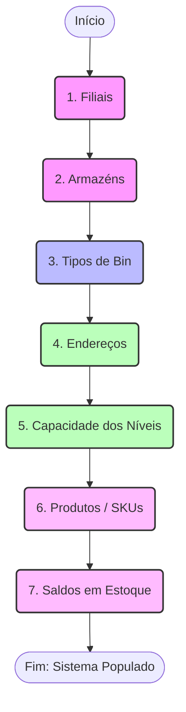
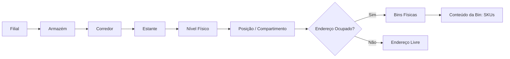
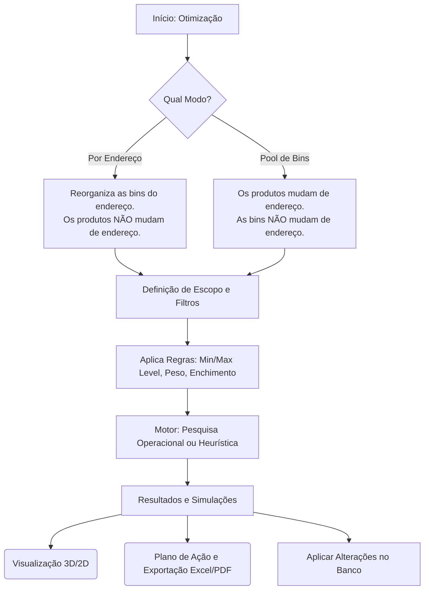
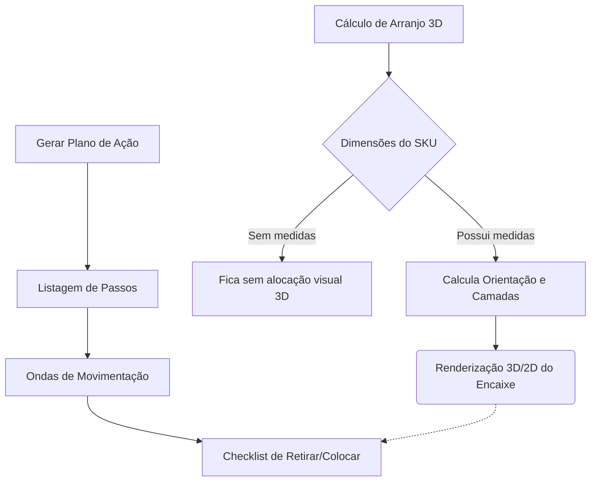
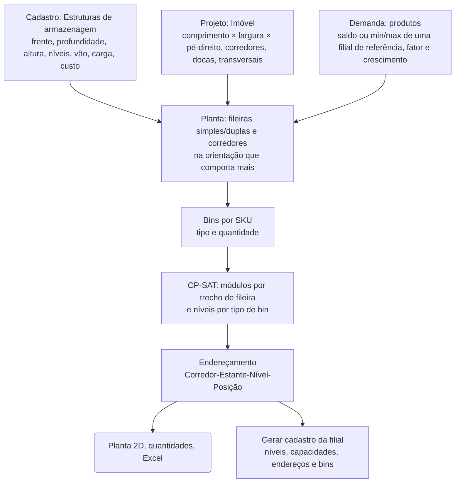

# Neokioski — Gestão de Estoque

Sistema web local para gestão física de depósitos, mapa visual do estoque e otimização de armazenagem em bins. Desenvolvido com FastAPI, Jinja2 e SQLite.

## 🚀 Como rodar

**Requisitos**: Python 3.10 ou superior.

**Windows**
```bash
python -m pip install -r requirements.txt
start.bat
```

**Linux/macOS**
```bash
python -m pip install -r requirements.txt
python -m uvicorn main:app --port 8000
```
*Acesse `http://127.0.0.1:8000`. O banco `neokioski.db` será criado automaticamente.*

---

## 1. Fluxo de Importação de Dados

A base do sistema exige a inserção correta de dados para mapear a realidade do armazém. O processo de importação segue uma hierarquia estrita para evitar erros de dependência.



*Nota: Ao sincronizar dados na importação, os registros que não constarem na nova planilha e que não estiverem em uso serão removidos automaticamente.*

---

## 2. Estrutura Física e Cadastros

O sistema organiza o estoque de forma física e visual, definindo claramente onde cada item está acondicionado.



- **Níveis e Capacidade**: Níveis têm restrição de quantidade de Bins e vão livre. Excesso de Bins em um endereço aloca os itens no "nível dedicado" acima.
- **Mapa (Layout)**: O sistema traça uma elevação frontal visual, em escala, dos corredores, com destaque por ocupação e links em 3D.
- **Compartimentos**: Bins que são divisões de uma Bin maior (ex: 1/6 de uma caixa).

---

## 3. Otimização de Bins

A ferramenta principal para compactar o armazém ou reorganizar SKUs, usando modelos matemáticos (Pesquisa Operacional com OR-Tools CP-SAT) ou Heurística.



---

## 4. Packing (Arranjo das Unidades) e Plano de Ação

O sistema calcula o encaixe geométrico dos itens e guia a movimentação através de Planos de Ação.



- **Visualização**: Cada item otimizado pode ser visto em uma tela `/optimization/case`, demonstrando o encaixe com o cenário atual, min-level e max-level, gerando os arranjos no espaço.
- **Planos Seguros**: Movimentações (De-Para) levam em consideração evitar conflito; em caso de troca circular, os itens aguardam na "Área de Espera".

---

## 5. Projeto de Filial Nova (greenfield)

Em **Otimização de bins → Projeto de filial nova** (`/optimization/site`) o sistema projeta uma filial do zero. O plano sai com a quantidade de estruturas e de bins, a planta e os endereços.



- **Estruturas** (`Cadastros → Estruturas de armazenagem`): cada módulo tem frente útil, profundidade, altura total, nº de níveis, vão útil por nível, carga por nível e custo.
- **Quantidade de estruturas**: para cada estrutura você escolhe *Otimizar quantidade* (o sistema decide, com mínimo/máximo opcionais), *Quantidade fixa* (por exemplo, estruturas já compradas: o plano mostra a sobra ou a falta) ou *Não usar*.
- **Objetivo**: menos módulos, menor custo ou menos metros de fileira. A prioridade é sempre esta: 1º guardar toda a demanda, 2º o objetivo, 3º o desempate e, por último, o menor nº de níveis ocupados.
- **Regras**: tipos de bin permitidos, enchimento máximo da bin, folga acima da bin e entre bins, aproveitamento da frente do nível, rotação, um tipo de bin por SKU e peso (da bin e da carga do nível). Cada nível recebe um único tipo de bin, e as bins maiores ficam nos níveis de baixo.
- **Importar dados da filial nova**: no projeto, *Baixar modelo* gera um Excel já preenchido com os dados atuais. Ele tem as abas **Imóvel** (campo/valor, em metros), **Estruturas** (medidas em cm; modo *Otimizar*, *Fixa* ou *Não usar*; qtd. fixa, mínimo e máximo), **Bins** (os códigos novos são cadastrados) e **SKUs** (SKU, produto, material, dimensões, peso, **saldo, min level e max level da filial nova**). Todas as abas são opcionais e podem ter qualquer nome e colunas em qualquer ordem: ao enviar, abre a tela de **mapeamento**, onde você escolhe a aba de cada tipo de dado e a coluna de cada campo, com prévia das linhas. As sugestões vêm dos nomes das abas e colunas e do mapeamento usado na última importação do projeto. Um CSV é lido como uma aba só. Os SKUs ficam no projeto, sem alterar produtos ou saldos, e a fonte da demanda passa a ser *Arquivo importado*. Dimensões vazias vêm do cadastro de produtos quando o SKU existe, e SKUs repetidos têm as quantidades somadas. Assim não é preciso ter uma filial existente como referência.
- **Cenários**: duplique o projeto para comparar alternativas (outro imóvel, outras estruturas, outro fator de demanda).
- **Saídas**: indicadores, planta vista de cima, quantidades por estrutura e por tipo de bin (incluindo as bins pai dos compartimentos), situação de cada SKU, lista de endereços e exportação para Excel. *Gerar cadastro da filial* cria a filial com níveis (vão e capacidade), endereços e bins. Opcionalmente vincula cada SKU ao seu endereço com saldo zerado.

---

## Estrutura do Projeto

- `main.py` : Entrypoint FastAPI.
- `database.py` : Motor SQLite + WAL, gerencia sessões e migrações transparentes.
- `models/` e `services/` : Modelagem das entidades e regras de negócios (endereços, geração em lotes, cálculos físicos).
- `routers/` e `templates/` : API REST / Views e os templates em Jinja2 (HTML/Bootstrap 5).

## Importante: Atualizar para uma nova versão

Substitua os arquivos do projeto e **mantenha o arquivo `neokioski.db`**. Ao iniciar, o sistema ajusta o banco sozinho: cria tabelas/colunas novas e reaplica as regras de consistência (ocupação dos endereços, endereço padrão dos produtos, níveis dedicados e vão dos níveis). Faça uma cópia de segurança do `.db` antes de prosseguir.
