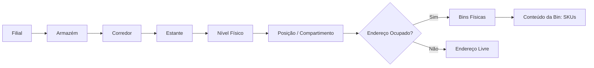
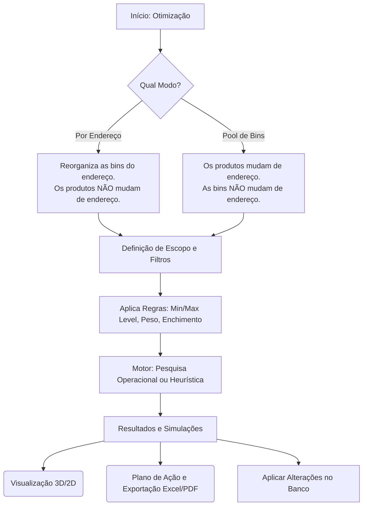
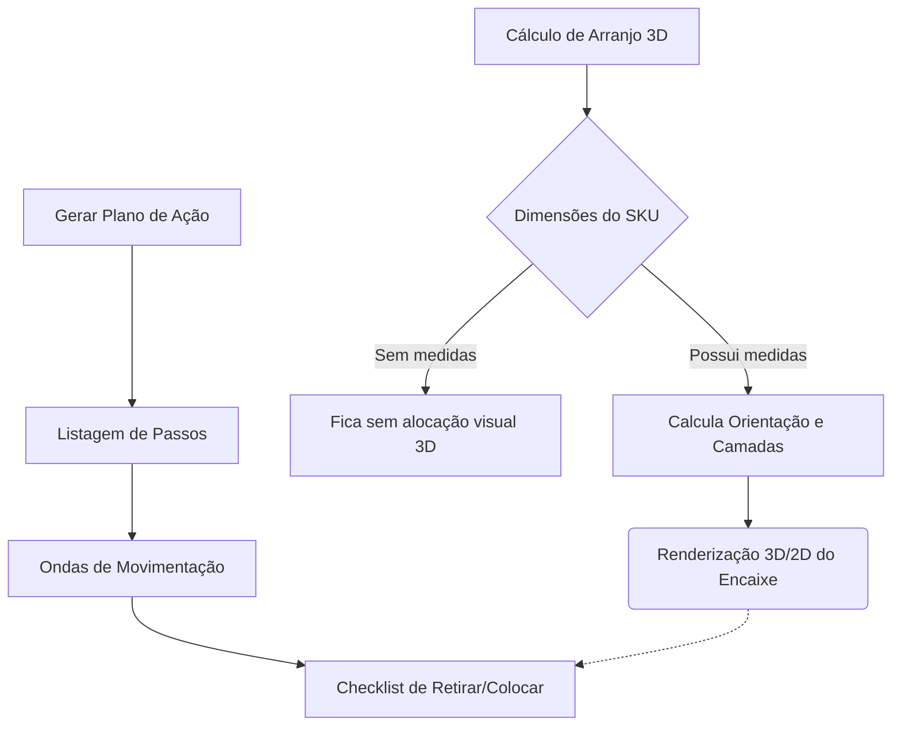
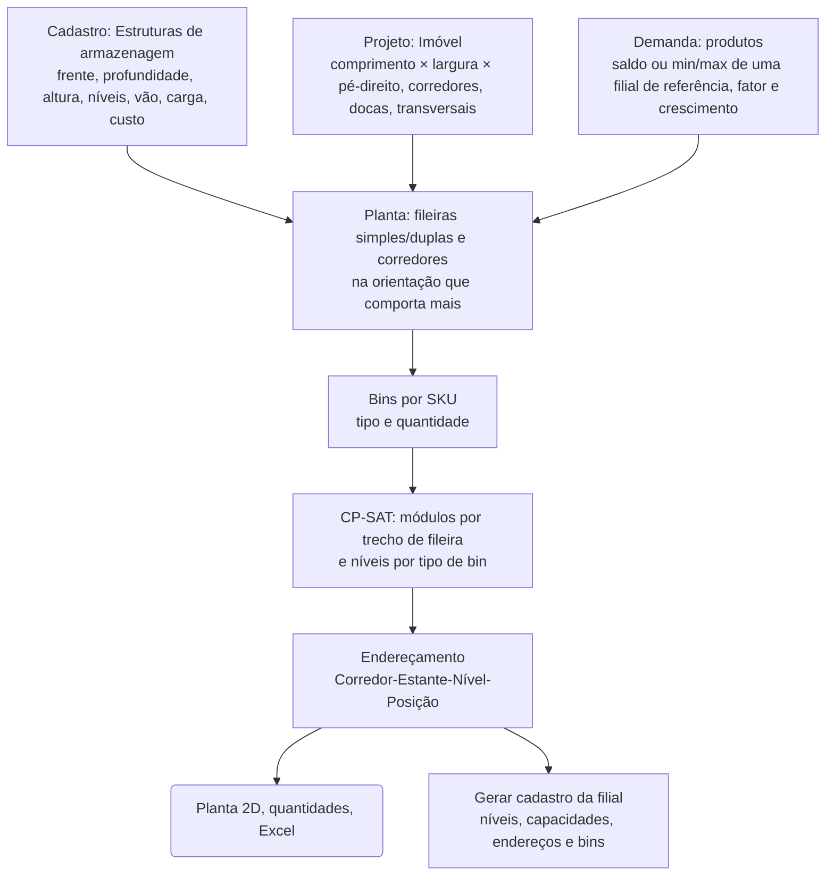

# Neokioski — Gestão de Estoque

Sistema web local para gestão física de depósitos, mapa visual do estoque e otimização de armazenagem em bins. Desenvolvido com FastAPI, Jinja2 e SQLite.

## 🚀 Como rodar

**Requisitos**: qualquer **Python 3.11 ou superior** (testado em 3.11, 3.12, 3.13 e 3.14). Não é preciso uma versão específica.

**Windows**: dê dois cliques em `start.bat` (ou rode no terminal):
```bash
start.bat
```

**Linux/macOS**:
```bash
./start.sh
```

*Acesse `http://127.0.0.1:8000`. O banco `neokioski.db` será criado automaticamente.*

O script faz o resto sozinho:
- **Sem `.venv`**: cria o ambiente virtual com o Python mais novo instalado que seja 3.11 ou superior. No Windows procura `py -3` e depois `python`/`python3` do PATH; no Linux/macOS, `python3.X`, `python3` e `python`.
- **`.venv` feita com Python anterior ao 3.11**: recria o ambiente.
- **`requirements.txt` alterado desde a última instalação**: atualiza as dependências. Nas outras vezes inicia direto.
- **Para escolher o Python**: `set NK_PYTHON=C:\caminho\python.exe` (Windows) ou `NK_PYTHON=/caminho/python3.13 ./start.sh`.
- **Para mudar a porta**: `NK_PORT=8080`.

Também funciona sem os scripts, dentro de qualquer ambiente com Python 3.11+:
```bash
python -m pip install -r requirements.txt
python -m uvicorn main:app --port 8000
```

---

## 1. Fluxo de Importação de Dados

A base do sistema exige a inserção correta de dados para mapear a realidade do armazém. O processo de importação segue uma hierarquia estrita para evitar erros de dependência.


*Nota: Ao sincronizar dados na importação, os registros que não constarem na nova planilha e que não estiverem em uso serão removidos automaticamente.*

---

## 2. Estrutura Física e Cadastros

O sistema organiza o estoque de forma física e visual, definindo claramente onde cada item está acondicionado.



- **Níveis e Capacidade**: Níveis têm restrição de quantidade de Bins e vão livre. Excesso de Bins em um endereço aloca os itens no "nível dedicado" acima.
- **Mapa (Layout)**: O sistema traça uma elevação frontal visual, em escala, dos corredores, com destaque por ocupação e links em 3D.
- **Compartimentos**: Bins que são divisões de uma Bin maior (ex: 1/6 de uma caixa).

---

### Produto único + política de estoque por filial

O **cadastro do produto é único** e vale para todas as filiais: SKU, nome, tipo de material, dimensões e peso. O que muda de uma filial para outra fica na **política de estoque** (tabela `stock_policies`, uma por produto × filial): **endereço padrão** na filial, **min level** e **max level**.

- **Tela do produto:** a tabela *Política de estoque por filial* tem filial, endereço padrão (a busca mostra só endereços daquela filial), mínimo e máximo. Dá para adicionar outra filial ou remover uma. O detalhe e a lista (coluna *Mín.–Máx. por filial*) mostram as políticas.
- **Endereço padrão automático:** continua a regra de antes, agora por filial. Com saldo na filial, o padrão é um dos endereços onde o produto está (o de maior saldo, se o escolhido não tiver saldo).
- **Importação de produtos:** dimensões atualizam o cadastro único. Min/max e endereço padrão vão para a política da filial da linha (ou da filial do endereço).
- **Otimizações** (Por endereço, Pool, cenários min/max) e **projeto de filial nova:** usam a política da filial do escopo ou de referência. "Todas as filiais" soma as políticas. Ao gerar o cadastro de uma filial nova, os produtos que já existem são reaproveitados, e só a política da filial nova é criada (min/max do arquivo e endereço padrão).
- **Migração automática** de bancos antigos (os campos ficavam no produto):
  - o endereço padrão vai para a política da filial desse endereço;
  - min/max vão para as filiais onde o produto tem saldo ou endereço padrão; sem nenhuma referência, para todas as filiais.

  Roda uma vez; as colunas antigas ficam no banco sem uso.

## 3. Otimização de Bins

A ferramenta principal para compactar o armazém ou reorganizar SKUs, usando modelos matemáticos (Pesquisa Operacional com OR-Tools CP-SAT) ou Heurística.



---

## 4. Packing (Arranjo das Unidades) e Plano de Ação

O sistema calcula o encaixe geométrico dos itens e guia a movimentação através de Planos de Ação.



- **Visualização**: Cada item otimizado pode ser visto em uma tela `/optimization/case`, demonstrando o encaixe com o cenário atual, min-level e max-level, gerando os arranjos no espaço.
- **Planos Seguros**: Movimentações (De-Para) levam em consideração evitar conflito; em caso de troca circular, os itens aguardam na "Área de Espera".

---

## 5. Projeto de Filial Nova (greenfield)

Em **Otimização de bins → Projeto de filial nova** (`/optimization/site`) o sistema projeta uma filial do zero. O plano sai com a quantidade de estruturas e de bins, a planta e os endereços.



- **Estruturas** (`Cadastros → Estruturas de armazenagem`): cada módulo tem frente útil, profundidade, altura total, nº de níveis, vão útil por nível, carga por nível e custo.
- **Zonas** (opcional): áreas com orientação de fileiras, largura de corredor, corredores transversais e estruturas permitidas próprias. Há dois modos:
  - **Posicionadas por X/Y:** cada zona é um retângulo em qualquer lugar do imóvel, como um obstáculo (X, Y, comprimento em X, largura em Y; largura vazia = até a parede), e o espaço entre as zonas é a circulação. Uma fileira pode ficar de frente para a borda da zona, e a ponta recebe cabeceira, quando do lado de fora há ao menos um corredor livre (sem parede, outra zona ou obstáculo). Zonas sobrepostas ou fora do imóvel são recusadas com mensagem clara.
  - **Empilhadas:** sem X/Y, as zonas são faixas ao longo do comprimento a partir da frente (docas), separadas por **avenidas** transversais.

  Exemplo de uso: num imóvel estreito com uma fileira só, o corredor termina na parede do fundo e o colaborador vai e volta. Com uma zona de fileiras **perpendiculares** de frente para a circulação, o caminho abre. O ganho de fluxo não entra no cálculo do solver, por isso é uma decisão do usuário. As zonas podem ser definidas na tela ou pela aba **Zonas** da planilha. A planta mostra o contorno e o nome de cada zona posicionada.
- **Áreas bloqueadas (obstáculos)**: escritório, sala, pilar, rampa… informados por posição X/Y, comprimento e largura (em metros, a partir do canto superior esquerdo da planta), na tela ou pela aba **Obstáculos** da planilha. As fileiras que passariam por eles são cortadas (com o afastamento das paredes), e a ponta cortada não recebe cabeceira. A planta, o PDF e o plano mostram o obstáculo.
- **Cabeceiras** (opção do imóvel, ligada por padrão): na ponta de cada trecho de fileira sobra um comprimento menor que um módulo. Um módulo **girado 90°** atravessa a fileira dupla (costas com costas) e aproveita esse espaço, de frente para o corredor transversal ou para uma faixa reservada com pelo menos a largura de um corredor. Pontas encostadas na parede não recebem cabeceira. O solver decide onde vale a pena. Na ponta final do trecho, a cabeceira fica **encostada na fileira** (padrão; a sobra vai para o lado da área livre) ou **alinhada à borda do trecho**, conforme a escolha no imóvel. As cabeceiras recebem estantes `C01`, `C02`… no corredor da fileira, aparecem tracejadas na planta e no PDF, e o plano de montagem indica a posição e para onde fica a frente.
- **Setores** (recebimento, expedição, conferência, embalagem…): na etapa *Zonas e circulação*, informe só o **nome e a área necessária** (opcional: lado mínimo e onde procurar: automático, junto às docas, fundo ou laterais). O sistema testa faixas encostadas nas paredes e cantos em várias proporções e escolhe, do maior setor para o menor, o lugar que **deixa mais posições de estrutura** (empate: o mais perto das docas). O setor entra na planta como área ocupada: corta as fileiras como um obstáculo.
  - Com *Posição fixa*, valem X/Y/comprimento/largura. Também dá para desenhar o setor com o mouse (ferramenta *Desenhar setor*).
  - Os setores aparecem na planta (os automáticos com "Mostrar fileiras"), no resultado, no PDF e no 3D (área verde no piso).
  - Na planilha, use a aba **Setores**. O exemplo *CD com porta-paletes e picking* traz recebimento e expedição.
- **Zona de ouro** (opcional, por estrutura, em *Cadastros → Estruturas*): faixa de altura (cm do piso) mais ergonômica para pegar.
  - **Como definir:** arraste no desenho da estrutura (vista de frente, com os níveis em escala e uma pessoa de 1,75 m de referência), puxe as bordas ou mova a faixa; o botão *Sugerir 75–150 cm* preenche o padrão.
  - **Quais níveis contam:** os níveis cuja altura de pega (meio do vão) cai na faixa.
  - **Onde aparece:** com estrela no plano detalhado, na coluna "Zona de ouro" da aba Níveis do Excel e no 3D (faixa dourada e a cor "Zona de ouro").
  - **Na planilha:** colunas *Zona de ouro início/fim (cm)* da aba Estruturas.
- **Posição dos SKUs pela saída (slotting)** — etapa *Posição dos SKUs*. Os mais procurados ficam nos melhores endereços, e os que saem juntos ficam perto.
  - **Dados de saída**, em duas opções:
    1. **Coluna "Saída"** na aba SKUs: você informa a saída de cada SKU no período, em linhas de pedido ou unidades.
    2. **Aba "Pedidos"** com o histórico do período: pedido, SKU, quantidade e, opcional, data. No mapeamento há a opção **Converter quantidades para valor absoluto**, para relatórios em que a saída vem negativa. Ela vem marcada quando a prévia tem negativos; sem ela, linhas negativas são ignoradas. O projeto guarda só o resumo: linhas de pedido e unidades por SKU, e os pares de SKUs que aparecem no mesmo pedido.

    Sem dados, dá para usar o max level como aproximação.
  - **Nota de facilidade de cada endereço:** caminhada em L (pelos corredores) até o **ponto de referência** + uma penalidade, em metros, quando o nível está fora da **zona de ouro** da estrutura. O ponto de referência é, por padrão, o setor de expedição (senão as docas), outro setor ou um X/Y.
  - **Duas zonas de ouro:**
    - **Da pega:** a faixa de altura ergonômica de cada estrutura.
    - **Da caminhada:** as posições até X m do ponto de referência. Sem valor informado, são as mais perto que somam 20% das bins.

    O resultado mostra as saídas em cada uma e nas duas. Na planta, a zona da caminhada aparece como um losango tracejado em volta da referência (distância em L); nos endereços, ícones de estrela (pega) e de pessoa andando (caminhada); no 3D, a cor *Zonas de ouro* (nas duas / só pega / só caminhada / fora). Os modos Por endereço e Pool têm os mesmos dois conceitos.
  - **Ordem de preenchimento:** popularidade **por bin** (muito procurado e pequeno primeiro). Os itens que saem juntos — com suporte mínimo de pedidos e força ≥ 30% — formam grupos que entram em sequência. Um SKU com parceiro já posicionado escolhe o nível com menor *caminhada + força × distância até o parceiro*. A quantidade de estruturas e níveis não muda.
  - **Resultado:**
    - caminhada média por saída, ponderada pela popularidade, comparada à de uma posição ao acaso;
    - curva ABC;
    - parcela das saídas na zona de ouro em relação à parcela de bins nela;
    - distância entre os pares que mais saem juntos, comparada a duas posições quaisquer.

    No 3D, a cor *Curva ABC* e o marcador do ponto de referência. No Excel, colunas de caminhada/zona de ouro (endereços) e saída/ABC (SKUs).
  - **Limite:** pares de SKUs com tipos de bin diferentes dependem de onde o solver pôs os níveis de cada tipo, então podem ficar longe.
  - Todos os projetos de exemplo trazem um mês de pedidos na aba **Pedidos**, com saídas negativas.
  - **Ponto de referência por X/Y com o mouse:** na etapa *Posição dos SKUs* há uma planta. Clicar nela marca o ponto (vira "Ponto X/Y informado"), e o marcador vermelho aparece em todas as plantas do projeto.
- **Custo total**: estrutura ou tipo de bin sem custo informado conta como R$ 0 (como no solver), e o cartão lista os itens sem custo.
- **Letras dos endereços** (no imóvel):
  - *Uma letra por corredor* (padrão): as duas fileiras de frente têm a mesma letra, com estantes ímpares de um lado e pares do outro.
  - *Uma letra por rua/fileira*: fileiras de frente uma para a outra têm letras diferentes (ex.: a rua X fica de frente para a Y, comum em CDs), com estantes 01, 02, 03… ao longo da fileira.

  - **Ruas em serpentina** (opção do modo por rua): a rua do outro lado do corredor é numerada ao contrário. B-01 fica de frente para o fim da A, e o separador desce uma rua e volta pela outra, sem voltar vazio ao início. A mesma opção existe na caminhada estimada dos modos Por endereço e Pool.

  Na planta, no PDF e no 3D, os corredores aparecem como "Ruas X | Y". Na planilha, é o campo *Endereçamento (corredor/rua)* da aba Imóvel. Nos modos Por endereço e Pool, a opção *Letras por rua* da posição pela saída faz a caminhada estimada entender que duas ruas dividem um corredor.
- **Peso**: com "Respeitar peso", o solver dimensiona os níveis pela carga máxima da estrutura (peso médio das bins de cada tipo e, se ainda faltar lugar, o da bin mais pesada). A alocação confere o peso bin a bin e, se precisar, usa um nível livre de estrutura compatível.
- **Quantidade de estruturas**: para cada estrutura você escolhe *Otimizar quantidade* (o sistema decide, com mínimo/máximo opcionais), *Quantidade fixa* (por exemplo, estruturas já compradas: o plano mostra a sobra ou a falta) ou *Não usar*.
- **Objetivo e desempates definidos pelo usuário**: escolha o objetivo e até 3 desempates em ordem, entre menos módulos, menor custo total (estruturas + bins), menos metros de fileira, menor custo de estruturas, menor custo de bins, menos bins e menos níveis ocupados. Guardar toda a demanda vem sempre em 1º lugar. Cada critério só desempata as soluções empatadas no anterior. Sem desempate escolhido vale o padrão do objetivo e, por último, menos níveis ocupados. Se algum critério depende das bins, o solver também escolhe as bins de cada SKU. O resultado lista o valor alcançado em cada etapa.
- **Regras**: tipos de bin permitidos, enchimento máximo da bin, folga acima da bin e entre bins, aproveitamento da frente do nível, rotação, um tipo de bin por SKU e peso (da bin e da carga do nível). Cada nível recebe um único tipo de bin, e as bins maiores ficam nos níveis de baixo.
- **Importar dados da filial nova**: no projeto, *Baixar modelo* gera um Excel já preenchido com os dados atuais. Ele tem as abas **Imóvel** (campo/valor, em metros), **Estruturas** (medidas em cm; modo *Otimizar*, *Fixa* ou *Não usar*; qtd. fixa, mínimo e máximo), **Bins** (os códigos novos são cadastrados) e **SKUs** (SKU, produto, material, dimensões, peso, **saldo, min level e max level da filial nova**). Todas as abas são opcionais e podem ter qualquer nome e colunas em qualquer ordem: ao enviar, abre a tela de **mapeamento**, onde você escolhe a aba de cada tipo de dado e a coluna de cada campo, com prévia das linhas. As sugestões vêm dos nomes das abas e colunas e do mapeamento usado na última importação do projeto. Um CSV é lido como uma aba só. Os SKUs ficam no projeto, sem alterar produtos ou saldos, e a fonte da demanda passa a ser *Arquivo importado*. Dimensões vazias vêm do cadastro de produtos quando o SKU existe, e SKUs repetidos têm as quantidades somadas. Assim não é preciso ter uma filial existente como referência.
- **Custos**: estruturas têm *custo por módulo* e tipos de bin têm *custo por bin* (num compartimento sem custo próprio, vale o custo da bin pai ÷ compartimentos). O objetivo **Menor custo total (estruturas + bins)** deixa o solver escolher também as bins de cada SKU, entre as melhores opções, pesando o custo delas contra o das estruturas que ocupam. O plano mostra o custo das estruturas, o das bins e o total.
- **Projetos de exemplo**: na tela de projetos há um catálogo de exemplos. Cada um mostra a planta antes de otimizar e tem os botões *Planilha* (download) e *Criar projeto*. Os exemplos são: *Galpão médio de picking*; *Fileiras nas paredes + escritório no canto* (5 zonas posicionadas por X/Y: fileiras perpendiculares nas paredes e junto ao escritório, fileiras horizontais no meio); *Imóvel estreito com avenida no fundo*; *CD com porta-paletes e picking* (zonas com corredores de 3,2 m e 1,2 m, itens volumosos em palete). Os dados ficam em `services/site_examples.py`, e as planilhas em `samples/exemplos/`, geradas por `python scripts/generate_site_seed.py` ou na hora, se faltarem. Ao importar uma planilha com a aba Estruturas, as estruturas que não estão nela ficam como "Não usar" no projeto.
- **Plano detalhado de implantação** (botão *Plano detalhado* no resultado, com download em **Excel** e **PDF**). Usa o mesmo plano aprovado na tela e traz:
  - cabeçalho com imóvel, demanda, regras e a ordem de prioridade dos critérios;
  - indicadores;
  - planta vista de cima;
  - **lista de compras** (estruturas e bins, com custo unitário e total; compartimentos viram as bins inteiras a comprar);
  - **passo a passo** em fases: 1. compras, 2. montagem de cada estante (fileira, lado do corredor e posição X/Y em metros a partir das paredes), 3. configuração dos níveis (tipo e quantidade de bins por nível) e etiquetagem, 4. abastecimento de cada endereço (bins, SKU e unidades), 5. pendências (SKUs não alocados);
  - tabelas de montagem, níveis, endereços e SKUs.

  Na tela, o checklist fica salvo no navegador e tem filtro. O Excel traz uma aba por seção, com a coluna "Feito".
- **Sugerir redução da demanda**: quando a demanda não cabe (ou para ver o limite), o botão *Sugerir redução da demanda* (etapa Demanda) calcula:
  - o **maior fator de demanda que cabe inteiro**, por busca binária com o solver;
  - **limites por SKU**: quanto de cada SKU cabe mantendo o fator atual;
  - os SKUs que mais consomem espaço e as estruturas que limitam.

  Você aplica o fator ou os limites com um clique. Os limites ficam salvos no projeto, a etapa Demanda avisa que estão ativos e o botão *Remover limites* os desfaz. Os SKUs limitados aparecem no resultado com a nota "redução da demanda".
- **Planta com medidas e edição com o mouse**: nas etapas *Imóvel* e *Zonas e circulação* aparece o desenho da planta em escala, com as cotas de comprimento e largura, as docas, as faixas reservadas, as zonas e os obstáculos. As caixas *Mostrar planta* e *Mostrar fileiras* (a planta que o servidor calcula para os valores do formulário, sem salvar) ficam lembradas no navegador. Na etapa Zonas há três ferramentas:
  - **Selecionar:** arraste para mover, use o canto para redimensionar e *Delete* para excluir;
  - **Nova zona:** arraste na planta para desenhar;
  - **Novo obstáculo:** arraste na planta para desenhar.

  Os valores (múltiplos de 0,1 m) vão direto para as tabelas, e vice-versa. Ao mover uma zona empilhada, ela passa a ser posicionada por X/Y.
- **Medidas nas plantas**: em todas as plantas aparece o seletor *Medidas*, com três opções:
  - **Ocultar:** sem medidas;
  - **Resumo:** só o tamanho do imóvel, ex.: 24 × 26 m;
  - **Completas:** cotas ao longo de toda a planta. Há a cota total e a cota encadeada nas bordas de cima (X) e da esquerda (Y), com as bordas de zonas, obstáculos, docas, avenidas e corredores. Também mostra o tamanho e a posição de cada zona e obstáculo.

  Em *Completas*, escolha também onde ficam as cotas:
  - **Por fora:** cotas encadeadas em volta da planta;
  - **Por dentro:** cada zona e obstáculo traz o próprio comprimento e largura, rente às bordas de baixo e da direita. É a melhor opção para criar zonas e obstáculos. Na etapa Zonas, a forma selecionada, a que está sendo desenhada e a que está sendo arrastada também mostram, em laranja e atualizada ao vivo, a distância até a vizinha mais próxima nos quatro lados. A vizinha pode ser uma zona, um obstáculo, a borda da zona que contém a forma ou a parede.

  O seletor está nas etapas Imóvel e Zonas, no resultado, no plano detalhado e no catálogo de exemplos. A escolha vale para todas as plantas, fica salva no navegador e também vale para o **PDF** (`plan.pdf?dims=none|summary|full&pos=out|in`).
- **Ocupação das bins** (além da ocupação dos níveis): volume dos produtos ÷ volume útil das bins alocadas. Aparece em vários lugares:
  - no total (cartão do resultado);
  - por tipo de bin, ao lado do *uso das posições*, que é bins alocadas ÷ posições reservadas nos níveis;
  - por SKU e por endereço;
  - no plano detalhado, no Excel e no PDF.

  Nos modos *Por endereço* e *Pool*, o indicador "Enchimento médio" passou a se chamar **Ocupação das bins** (antes → depois). No Pool, o "depois" conta só as unidades que o plano guarda em bins; SKUs sem bin não entram, e antes faziam a ocupação passar de 100%.
- **Arranjo 3D** (botão *Ver em 3D* no resultado e no plano detalhado; `/optimization/site/{id}/3d`): mostra a filial em 3D, com piso, corredores, zonas, obstáculos, estantes com os níveis e **cada bin no seu lugar**. Os dados vêm do mesmo plano exibido na tela (`plan3d.json`).
  - **Cores:** por tipo de bin, por ocupação das bins (vermelho → verde), por estrutura ou por SKU.
  - **Filtros e cortes:** filtro por corredor e corte por altura, para ver os níveis de dentro.
  - **Busca e seleção:** busca por SKU ou endereço (destaca as bins). Clicar numa bin mostra o endereço, o SKU, o tipo de bin, a ocupação e a estante.
  - **Exibição:** liga/desliga bins, estruturas e paredes, e vistas 3D, de cima e de frente.
  - **Navegação:** a roda aproxima em direção ao ponto sob o mouse. Perto do alvo, o zoom continua avançando dentro do imóvel, e a câmera não atravessa o piso. O duplo clique centraliza a câmera no ponto clicado.

  Usa Three.js (CDN jsdelivr, versão fixa). Lógica da geometria em `services/site_3d.py`.
- **Cenários**: duplique o projeto para comparar alternativas (outro imóvel, outras estruturas, outro fator de demanda).
- **Saídas**: indicadores, planta vista de cima, quantidades por estrutura e por tipo de bin (incluindo as bins pai dos compartimentos), situação de cada SKU, lista de endereços e o plano detalhado (tela, Excel e PDF). *Gerar cadastro da filial* cria **exatamente o plano exibido**: a filial, as estantes com a estrutura, os níveis (vão e capacidade), os endereços e as bins. Também cadastra os **produtos** que ainda não existem (nome, material, dimensões, peso, min e max level), inclusive os SKUs do arquivo que ficaram fora do plano. Opcionalmente atualiza os produtos existentes com os dados do arquivo, **atribui cada produto aos seus endereços** (saldo zerado ou o saldo do arquivo dividido na proporção do plano) e define o **endereço padrão** (só para quem não tem, para todos ou nenhum).

---

## 6. Telas em passo a passo

As telas de otimização (Por endereço, Pool e Projeto de filial nova) mostram uma etapa por vez:
- **Por endereço e Pool:** Escopo → O que otimizar → Restrições.
- **Projeto de filial nova:** Imóvel → Zonas e circulação → Estruturas → Demanda → Bins e regras → Objetivo.

A barra de etapas é clicável, há botões Anterior/Próximo e a etapa atual é lembrada durante a sessão. Se faltar um campo obrigatório numa etapa escondida, a tela abre essa etapa. Depois de rodar, a tela abre na última etapa, com o resultado logo abaixo. O componente é genérico (`data-stepper` + `.nk-step` em `templates/base.html`).

## 6.0 Relatório de SKUs: popularidade e afinidade

Fica em `/optimization/site/{id}/skus` no projeto (link no cartão *Posição dos SKUs* e na etapa) e em `/optimization/slotting/skus?branch_id=…` nas filiais existentes (link no histórico de saídas). Também sai em **Excel**, com as abas SKUs, Pares e Resumo.

- **Por SKU:**
  - linhas de pedido (visitas ao endereço), unidades, % das saídas e % acumulado, curva ABC e % dos pedidos;
  - **onde está:** endereço, caminhada até a referência, zona de ouro da pega e da caminhada;
  - **sai junto com:** os parceiros mais frequentes, com pedidos juntos, força e lift.
- **Pares que mais saem juntos:**
  - **força:** fração dos pedidos do menos vendido em que os dois aparecem juntos;
  - **lift:** quantas vezes saem juntos mais do que sairiam por acaso (1 = acaso).

## 6.0.1 Simulador de trajeto pelos pedidos

Fica em `/optimization/site/{id}/routes` no projeto (link no cartão *Posição dos SKUs*) e em `/optimization/slotting/routes?branch_id=…` nas filiais existentes (link no histórico de saídas). Usa uma **amostra de até 3.000 pedidos**, guardada ao importar a aba Pedidos. Históricos enviados antes desta versão precisam ser importados de novo.

Cada pedido sai do ponto de referência, passa por um endereço de cada SKU (o mais perto da referência) e volta. São três rotas no mesmo plano:
- **Lista:** na ordem dos endereços, como a lista de separação costuma sair. Mostra o efeito da numeração (por exemplo, a serpentina).
- **Serpentina:** rota em S, com os corredores em ordem e alternando o sentido.
- **Otimizada:** a melhor entre vizinho mais próximo + 2-opt e as outras duas.

**Distância:**
- **No projeto:** pelos corredores. Para trocar de corredor, sai pela ponta ou por um transversal.
- **Nas filiais existentes:** a estimada pelo endereço.

**Resultado:** caminhada média por pedido e por linha, mediana e 90º percentil, total, e quanto a rota otimizada economizaria. No projeto, a planta desenha as três rotas do pedido escolhido, com as paradas numeradas. No exemplo de galpão médio com letra por rua, a lista sem serpentina anda cerca de 4% mais que a rota em S; com serpentina, a lista praticamente coincide com ela.

## 6.0.2 Resultados salvos e comparação

Cada execução de otimização fica guardada (tabela `optimization_runs`): Por endereço, Pool e Projeto de filial nova. Ficam os parâmetros, os indicadores (antes → depois, ou o valor no projeto), as situações e os detalhes (linhas da tabela, até 3.000; no projeto também estruturas e bins).
- **Sem duplicar:** a mesma execução (mesmos parâmetros e os mesmos dados de entrada) não é repetida; paginar ou ordenar a tela não cria outro registro.
- **Aba Resultados salvos** (`/optimization/runs`):
  - filtro por modo, filial e texto;
  - nome/observação em cada resultado;
  - Excel (indicadores, detalhes e parâmetros), reabrir com os mesmos parâmetros e excluir.
- **Comparar:** marque dois ou mais resultados. A tela mostra os indicadores lado a lado, com a diferença em relação ao 1º (verde = melhor, vermelho = pior), e a tabela dos parâmetros que mudaram.
- **Após rodar:** a própria tela do resultado mostra "Resultado salvo como nº …" com o link para comparar.

## 6.1 Posição pela saída nos modos Por endereço e Pool

A posição dos SKUs pela saída também vale para as filiais existentes: é a etapa **Posição pela saída** nas telas *Por endereço* e *Pool*.

- **Histórico de saídas por filial:** envie uma planilha com a aba **Pedidos** (pedido, SKU, quantidade, data opcional) ou uma lista de SKUs com a coluna **Saída**. Há a opção *Converter quantidades para valor absoluto*. O histórico fica salvo para a filial do escopo, só o resumo (tabela `pick_histories`), e pode ser substituído ou removido.
- **Caminhada estimada pelo endereço:** o sistema não tem a planta de uma filial existente, então a conta é: corredores de distância até o *corredor mais perto da expedição* × *distância entre corredores* + posição da estante no corredor × *frente da estante*. As estantes 01/02 ficam na ponta da expedição; ímpares de um lado e pares do outro.
- **Zona de ouro:** vem da estrutura cadastrada na estante (início/fim em cm). Sem estrutura, vale o campo *Níveis de ouro* (ex.: 2,3). Um nível fora dela "custa" os metros informados.
- **Pool:** os SKUs mais procurados por bin escolhem primeiro e, entre bins equivalentes, ficam nos endereços mais fáceis. Os itens C não disputam esses endereços, e quem sai junto fica perto do parceiro já posicionado. O objetivo do pool (menos bins, volume…) continua mandando: a posição pela saída entra como desempate antes da proximidade de hoje. Com a posição pela saída ligada, o pool usa o motor heurístico.
- **Por endereço:** os produtos ficam nos endereços, então o resultado sugere **trocas de endereço aos pares**. As trocas são entre endereços com um único SKU e exatamente as mesmas bins (sempre viáveis), e só quando o mais procurado ganha pelo menos 2 m. As trocas não são aplicadas automaticamente.
- **Indicadores hoje → plano/trocas:** caminhada média por saída (ponderada pela popularidade; também a de uma posição ao acaso), saídas na zona de ouro e distância entre os pares que mais saem juntos.

## 7. Estruturas de armazenagem nos depósitos existentes

As estruturas cadastradas também descrevem as estantes que já existem (vínculo *estante → estrutura*):

- **Capacidade dos níveis → Aplicar estrutura**: escolha as estantes (corredor/estante, aceita faixas como `01-04`) e a estrutura. O sistema grava o vínculo, define o vão de cada nível e calcula quantas bins de cada tipo cabem por nível (frente × profundidade do módulo, altura da bin + folga). Opcionalmente cria os níveis que faltam e substitui as capacidades existentes. A tabela mostra a estrutura de cada estante.
- **Gerar endereços em lote**: as estantes geradas podem receber uma estrutura na hora.
- **Mapa do estoque**: a estante mostra a estrutura (▤ código, com as medidas no tooltip). A largura do nível passa a ser a frente do módulo, e o vão da estrutura vale quando o nível não tem vão próprio.
- **Projeto de filial nova → Gerar cadastro da filial**: cada estante criada já fica vinculada à estrutura do plano.
- **Otimização por endereço e pool**: novo critério/objetivo **Menor custo de bins (R$)**, na heurística e na pesquisa operacional, que também pode entrar na ordem de prioridade.
- Uma estrutura em uso por alguma estante não pode ser excluída.

---

## Estrutura do Projeto

- `main.py` : Entrypoint FastAPI.
- `database.py` : Motor SQLite + WAL, gerencia sessões e migrações transparentes.
- `models/` e `services/` : Modelagem das entidades e regras de negócios (endereços, geração em lotes, cálculos físicos).
- `routers/` e `templates/` : API REST / Views e os templates em Jinja2 (HTML/Bootstrap 5).

## Importante: Atualizar para uma nova versão

Substitua os arquivos do projeto e **mantenha o arquivo `neokioski.db`**. Ao iniciar, o sistema ajusta o banco sozinho: cria tabelas/colunas novas e reaplica as regras de consistência (ocupação dos endereços, endereço padrão dos produtos, níveis dedicados e vão dos níveis). Faça uma cópia de segurança do `.db` antes de prosseguir.
