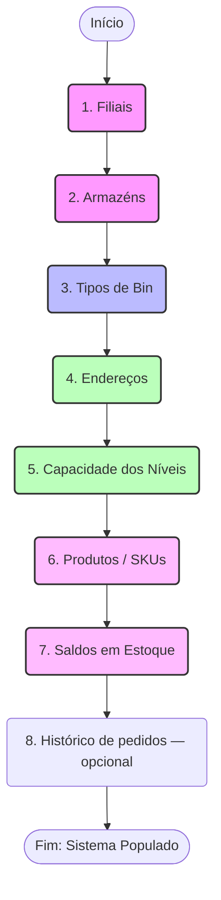
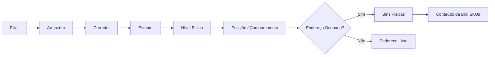
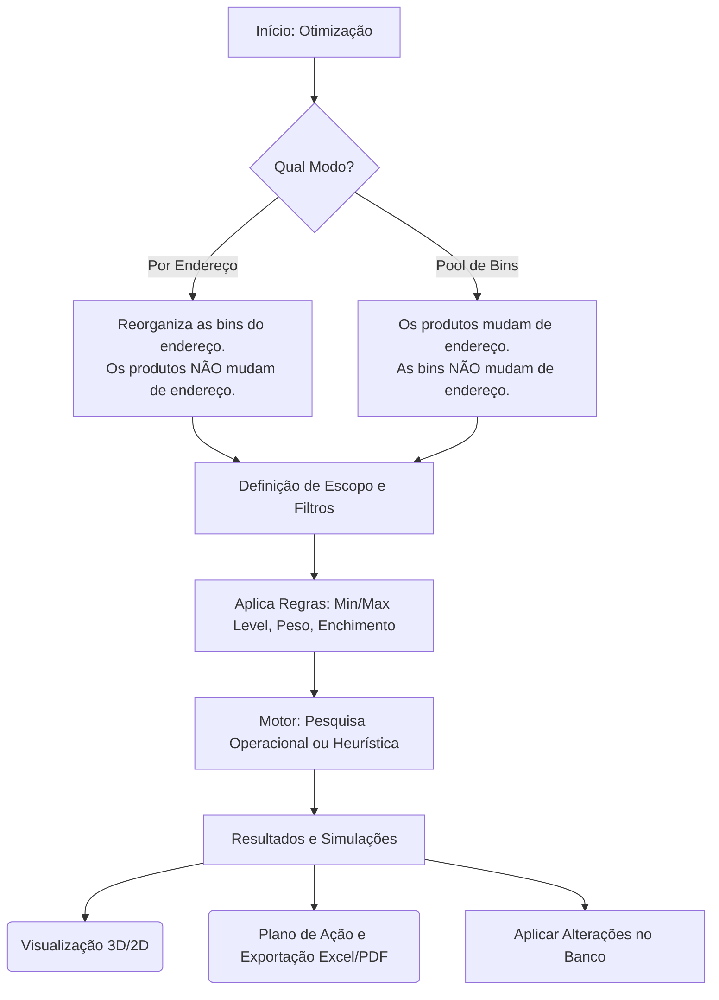
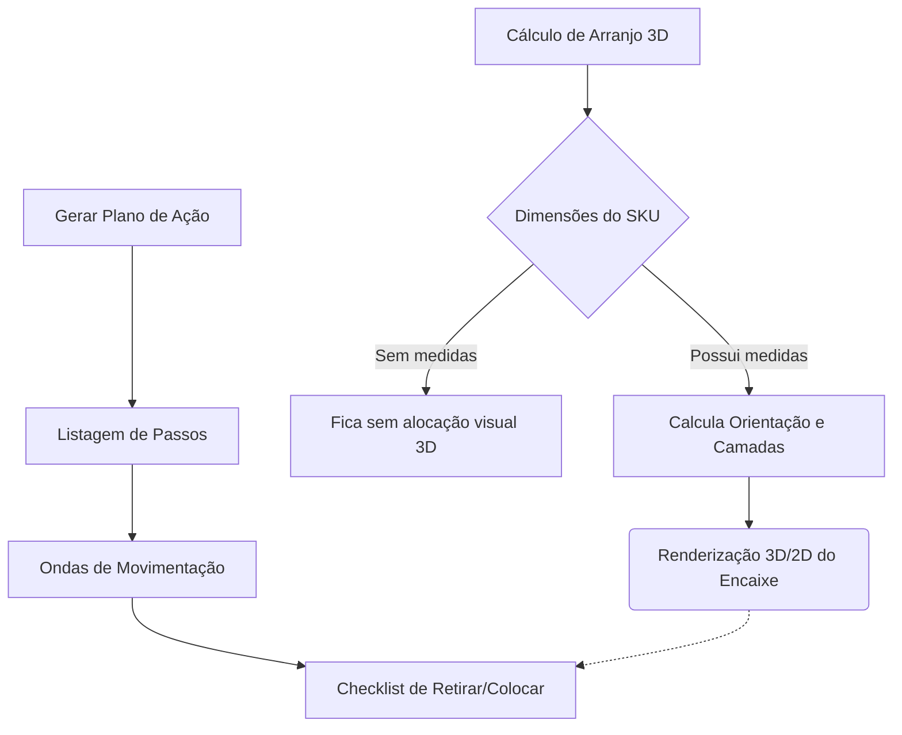
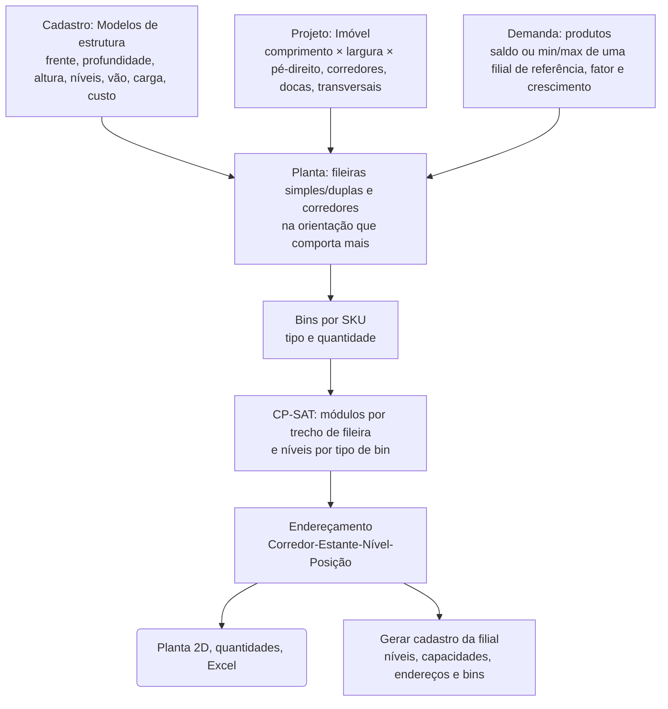

<p align="center"></p>

<p align="center"><b>Cada item no lugar certo. Cada passo contado.</b></p>

# Slotta — Gestão e otimização de armazenagem

Sistema web local para gestão física de depósitos, mapa visual do estoque e otimização de armazenagem em bins: escolha das bins de cada endereço (Por endereço e Pool), posição dos produtos pela saída, projeto de filiais novas, planta desenhada, simulador de trajeto e vista 3D. Desenvolvido com FastAPI, Jinja2, SQLite e OR-Tools (CP-SAT).

## 🚀 Como rodar

**Requisitos**: qualquer **Python 3.11 ou superior** (testado em 3.11, 3.12, 3.13 e 3.14). Não é preciso uma versão específica.

**Windows**: dê dois cliques em `start.bat` (ou rode no terminal):
```bash
start.bat
```

**Linux/macOS**:
```bash
./start.sh
```

*Acesse `http://127.0.0.1:8000`. O banco `slotta.db` será criado automaticamente (instalações anteriores à troca do nome continuam usando o `neokioski.db` que já existe).*

O script faz o resto sozinho:
- **Sem `.venv`**: cria o ambiente virtual com o Python mais novo instalado que seja 3.11 ou superior. No Windows procura `py -3` e depois `python`/`python3` do PATH; no Linux/macOS, `python3.X`, `python3` e `python`.
- **`.venv` feita com Python anterior ao 3.11**: recria o ambiente.
- **`requirements.txt` alterado desde a última instalação**: atualiza as dependências. Nas outras vezes inicia direto.
- **Para escolher o Python**: `set NK_PYTHON=C:\caminho\python.exe` (Windows) ou `NK_PYTHON=/caminho/python3.13 ./start.sh`.
- **Para mudar a porta**: `NK_PORT=8080`.

Também funciona sem os scripts, dentro de qualquer ambiente com Python 3.11+:
```bash
python -m pip install -r requirements.txt
python -m uvicorn main:app --port 8000
```

---

## 🔐 Acesso (login e usuários)

Todas as telas exigem login. No primeiro uso (banco sem usuários) o sistema cria o administrador **`admin`**:

- sem configuração, ele entra com a **senha de instalação** (entregue à parte; no código fica só o hash) e é obrigado
  a definir uma senha nova no primeiro acesso;
- para outra senha inicial, defina a variável `SLOTTA_ADMIN_PASSWORD` antes do primeiro início.

Administradores criam usuários em **menu do usuário → Usuários** (senha provisória, perfil, ativar/desativar). Cada
pessoa troca a própria senha em **Minha conta**. Detalhes:

- senhas guardadas só como hash PBKDF2-SHA256 (600 mil iterações); sessões no banco, cookie `HttpOnly`/`SameSite=Lax`,
  válidas por 14 dias com uso;
- 5 tentativas erradas seguidas bloqueiam o usuário por 5 minutos; trocar a senha encerra as sessões nos outros
  aparelhos; desativar o usuário encerra todas;
- o onboarding (tours vistos e convite do guia no Painel) é **por usuário**. Para zerar: **Guia → Reiniciar o
  onboarding** (o próprio usuário) ou **Usuários → zerar** (o administrador, para qualquer usuário).
- Esqueceu a senha do único administrador? Pare o app e rode
  `python -c "from database import *; from models import User; from services.auth import hash_password as h; db=SessionLocal(); u=db.query(User).filter_by(username='admin').one(); u.password_hash=h('NovaSenha123'); u.must_change_password=True; db.commit()"`.

## 🧭 Navegação

- **Barra do topo:** a marca (volta ao Painel), o idioma e as unidades, o **Guia**, o usuário e a **ajuda nos campos**.
- **Menu lateral** (sidenav), por assunto:
  - *Estoque*: Mapa do estoque, Planta da filial e Saldos;
  - *Planejamento*: **Otimização de bins** (Por endereço, Pool, Projeto de filial nova, Resultados salvos) e
    **Simulador** (Simular trajeto e 3D, Histórico de pedidos, Tempos padrão);
  - *Dados*: Cadastros e Importações;
  - *Sistema*: Configurações.

  O grupo da tela aberta já vem expandido, com o item em destaque. Em tela larga, o botão ☰ ao lado da marca
  alterna entre **expandido → só os ícones → oculto** (a tela passa a usar a largura toda) e volta ao expandido; o
  texto do botão diz o que o próximo clique faz, e a escolha fica lembrada no navegador. Em telas estreitas, o menu
  abre e fecha pelo ☰.
- **Simulador** (`/simulator`): a porta de entrada da simulação. Lista as filiais (histórico de pedidos — pedidos,
  dias e se tem o horário de liberação — e se a planta está desenhada) e os projetos de filial nova (aba Pedidos),
  com os atalhos para o **simulador de trajeto**, a **caminhada em 3D** e o **relatório de SKUs**. O que falta para
  simular aparece na linha (enviar o histórico, desenhar a planta).

## 1. Fluxo de Importação de Dados

A base do sistema exige a inserção correta de dados para mapear a realidade do armazém. O processo de importação segue uma hierarquia estrita para evitar erros de dependência.



As importações ficam em **Importações** (`/imports`), na mesma ordem. O histórico de pedidos só é preciso para a posição pela saída e o simulador de trajeto (ver 6.0.1 e 6.1). Estruturas, tipos de estrutura e peças são cadastrados na tela ou vêm na planilha do projeto de filial nova.

**Estruturas** (Importações → Estruturas, depois dos endereços), cada uma com modelo CSV:
- **Peças de estrutura:** código, nome e custo por peça.
- **Tipos de estrutura e composição:** paletes no piso, passo da furação, espessura do nível, condição de armazenagem,
  porta (sem / de giro / de correr, folhas, dobradiça, abertura e tempo) e modelo 3D (automático, simples ou da
  biblioteca). Várias linhas do mesmo tipo com *Peça*, *Qtd*, *Por* (módulo ou nível) e *Cor no 3D* montam a
  composição; com peças no arquivo, a composição do tipo passa a ser a do arquivo. Peça inexistente é cadastrada com o
  código.
- **Modelos de estrutura:** código, tipo (criado se não existir), frente, profundidade, altura, níveis, vão útil,
  vãos por nível (60/40/35), 1º nível, carga, custo e zona de ouro. A capacidade das estantes com a estrutura é
  recalculada.
- **Estrutura das estantes:** filial, armazém, corredor e estante (aceitam lista e faixa), a estrutura (ou "remover"),
  a folga acima da bin, o 1º nível e as opções criar níveis que faltam e remover limites manuais — o mesmo que
  *Capacidade dos níveis → Aplicar modelo*.

Os tipos de bin também importam *Aberta em cima (sim/não)* e *Máximo acima da borda (cm)* (ver 6.0.11).

*Nota: Ao sincronizar dados na importação, os registros que não constarem na nova planilha e que não estiverem em uso serão removidos automaticamente.*

---

## 2. Estrutura Física e Cadastros

O sistema organiza o estoque de forma física e visual, definindo claramente onde cada item está acondicionado.



- **Níveis e Capacidade**: Níveis têm restrição de quantidade de Bins e vão livre. Nas estantes com estrutura, a capacidade é calculada pelas medidas (ver 7.1). Excesso de Bins em um endereço aloca os itens no "nível dedicado" acima.
- **Mapa (Layout)**: O sistema traça uma elevação frontal visual, em escala, dos corredores, com destaque por ocupação e links em 3D.
- **Compartimentos**: Bins que são divisões de uma Bin maior (ex: 1/6 de uma caixa).
- **Fracionar e juntar a bin pai na otimização** (`services/bin_family.py`, `services/pool_family.py`): no cadastro do
  compartimento (onde se escolhe a bin pai) e na importação de tipos de bin (coluna *Permite fracionar a bin pai*,
  sim/não), a opção **Permitir fracionar a bin pai na otimização**. Com bins **Existentes**, a bin pai e esses
  compartimentos são a mesma caixa, com ou sem a divisória: a bin pai pode virar compartimentos (**fracionar**) e os
  compartimentos de uma mesma bin pai podem voltar a ser a bin pai inteira (**juntar**). Sem a opção, nada muda de forma.
  - **Por endereço**: a família é contada em bins pai — cada endereço usa as bins pai inteiras + ⌈n/k⌉ por tipo de
    compartimento (n compartimentos de k por bin pai), e o total não passa do que existe no escopo. Isso faz as irmãs
    ficarem na mesma bin pai (meia bin sozinha num endereço gasta uma bin pai). Heurística e CP-SAT (o mínimo de bins
    pai divididas é o último desempate). O resultado mostra quantas bins pai fracionar e quantas juntar, e os
    compartimentos que ficam vazios; o plano de ação começa com os passos **Fracionar** / **Juntar**. Aplicar só alguns
    endereços puxa junto os que liberam a bin pai.
  - **Pool** (as bins ficam no lugar, só mudam de forma): os compartimentos de um tipo, no mesmo endereço e nível,
    formam grupos de k (cada grupo é uma bin pai). Na escolha das bins, depois da zona de ouro e da caminhada, vale o
    compartimento de uma bin pai já usada (com a posição pela saída, ele ganha até ≈ 1 m de tolerância). Depois do
    plano, o Pool **consolida**: tenta esvaziar as bins pai divididas menos usadas, levando o conteúdo para compartimentos
    vazios de outras já usadas — só se a caminhada não piora mais que 1 m, não sai da zona de ouro da pega e o SKU
    continua num endereço só (quando não pode dividir). Cada bin pai dividida que fica vazia é **juntada** (volta a
    ser a bin pai inteira). Quando falta bin para algum SKU, **fraciona** bins pai que guardam pouco (o conteúdo cabe
    num compartimento) ou junta compartimentos vazios para quem só cabe na bin pai, e roda de novo. Aplicar grava as
    bins de cada endereço (LocationBin), renumera e grava o conteúdo; o plano de ação tem **Fracionar** antes das
    movimentações e **Juntar** depois.
  - No Recurso infinito, não se aplica (os compartimentos já podem ser usados à vontade).

---

### Produto único + política de estoque por filial

O **cadastro do produto é único** e vale para todas as filiais: SKU, nome, tipo de material, dimensões e peso. O que muda de uma filial para outra fica na **política de estoque** (tabela `stock_policies`, uma por produto × filial): **endereço padrão** na filial, **min level** e **max level**.

- **Tela do produto:** a tabela *Política de estoque por filial* tem filial, endereço padrão (a busca mostra só endereços daquela filial), mínimo e máximo. Dá para adicionar outra filial ou remover uma. O detalhe e a lista (coluna *Mín.–Máx. por filial*) mostram as políticas.
- **Endereço padrão automático:** continua a regra de antes, agora por filial. Com saldo na filial, o padrão é um dos endereços onde o produto está (o de maior saldo, se o escolhido não tiver saldo).
- **Importação de produtos:** dimensões atualizam o cadastro único. Min/max e endereço padrão vão para a política da filial da linha (ou da filial do endereço).
- **Otimizações** (Por endereço, Pool, cenários min/max) e **projeto de filial nova:** usam a política da filial do escopo ou de referência. "Todas as filiais" soma as políticas. Ao gerar o cadastro de uma filial nova, os produtos que já existem são reaproveitados, e só a política da filial nova é criada (min/max do arquivo e endereço padrão).
- **Migração automática** de bancos antigos (os campos ficavam no produto):
  - o endereço padrão vai para a política da filial desse endereço;
  - min/max vão para as filiais onde o produto tem saldo ou endereço padrão; sem nenhuma referência, para todas as filiais.

  Roda uma vez; as colunas antigas ficam no banco sem uso.

## 3. Otimização de Bins

A ferramenta principal para compactar o armazém ou reorganizar SKUs, usando modelos matemáticos (Pesquisa Operacional com OR-Tools CP-SAT) ou Heurística.

**Como as peças são encaixadas na bin:** o sistema não posiciona peça a peça. A capacidade de um SKU numa bin é o menor entre o **encaixe em grade** (todas as peças do SKU na mesma orientação, a melhor das permitidas: 2 em "só girar no plano", com a altura para cima, ou 6 em "qualquer orientação"), o **volume × enchimento máximo** e o **peso máximo**. Vários SKUs na mesma bin ficam em faixas ao longo do comprimento, cada um com a sua melhor orientação (o arranjo desenhado é aproximado). O solver escolhe tipos, quantidades e endereços das bins sobre essa capacidade já calculada; não faz empacotamento 3D com orientações misturadas, então o cálculo é conservador (um arranjo fora da grade pode caber mais peças do que o sistema conta).



---

## 4. Packing (Arranjo das Unidades) e Plano de Ação

O sistema calcula o encaixe geométrico dos itens e guia a movimentação através de Planos de Ação.



- **Visualização**: Cada item otimizado pode ser visto em uma tela `/optimization/case`, demonstrando o encaixe com o cenário atual, min-level e max-level, gerando os arranjos no espaço.
- **Planos Seguros**: Movimentações (De-Para) levam em consideração evitar conflito; em caso de troca circular, os itens aguardam na "Área de Espera".

---

## 5. Projeto de Filial Nova (greenfield)

Em **Otimização de bins → Projeto de filial nova** (`/optimization/site`) o sistema projeta uma filial do zero. O plano sai com a quantidade de estruturas e de bins, a planta e os endereços.



- **Modelos de estrutura** (`Cadastros → Modelos de estrutura`): cada modelo (a especificação que várias estantes físicas seguem) tem tipo, frente útil, profundidade, altura total, nº de níveis, vão útil por nível, carga por nível e custo. O tipo de estrutura (ver 6.0.9) traz a composição de peças, a aparência no 3D, a condição de armazenagem e a porta (ver 6.0.10).
- **Zonas** (opcional): áreas com orientação de fileiras, largura de corredor, corredores transversais e estruturas permitidas próprias. Há dois modos:
  - **Posicionadas por X/Y:** cada zona é um retângulo em qualquer lugar do imóvel, como um obstáculo (X, Y, comprimento em X, largura em Y; largura vazia = até a parede), e o espaço entre as zonas é a circulação. Uma fileira pode ficar de frente para a borda da zona, e a ponta recebe cabeceira, quando do lado de fora há ao menos um corredor livre (sem parede, outra zona ou obstáculo). Zonas sobrepostas ou fora do imóvel são recusadas com mensagem clara.
  - **Empilhadas:** sem X/Y, as zonas são faixas ao longo do comprimento a partir da frente (docas), separadas por **avenidas** transversais.

  Exemplo de uso: num imóvel estreito com uma fileira só, o corredor termina na parede do fundo e o colaborador vai e volta. Com uma zona de fileiras **perpendiculares** de frente para a circulação, o caminho abre. O ganho de fluxo não entra no cálculo do solver, por isso é uma decisão do usuário. As zonas podem ser definidas na tela ou pela aba **Zonas** da planilha. A planta mostra o contorno e o nome de cada zona posicionada.
- **Áreas bloqueadas (obstáculos)**: escritório, sala, pilar, rampa… informados por posição X/Y, comprimento e largura (em metros, a partir do canto superior esquerdo da planta), na tela ou pela aba **Obstáculos** da planilha. As fileiras que passariam por eles são cortadas (com o afastamento das paredes), e a ponta cortada não recebe cabeceira. A planta, o PDF e o plano mostram o obstáculo.
- **Cabeceiras** (opção do imóvel, ligada por padrão): na ponta de cada trecho de fileira sobra um comprimento menor que um módulo. Um módulo **girado 90°** atravessa a fileira dupla (costas com costas) e aproveita esse espaço, de frente para o corredor transversal ou para uma faixa reservada com pelo menos a largura de um corredor. Pontas encostadas na parede não recebem cabeceira. O solver decide onde vale a pena. Na ponta final do trecho, a cabeceira fica **encostada na fileira** (padrão; a sobra vai para o lado da área livre) ou **alinhada à borda do trecho**, conforme a escolha no imóvel. As cabeceiras recebem estantes `C01`, `C02`… no corredor da fileira, aparecem tracejadas na planta e no PDF, e o plano de montagem indica a posição e para onde fica a frente.
- **Setores** (recebimento, expedição, conferência, embalagem…): na etapa *Zonas e circulação*, informe só o **nome e a área necessária** (opcional: lado mínimo e onde procurar: automático, junto às docas, fundo ou laterais). O sistema testa faixas encostadas nas paredes e cantos em várias proporções e escolhe, do maior setor para o menor, o lugar que **deixa mais posições de estrutura** (empate: o mais perto das docas). O setor entra na planta como área ocupada: corta as fileiras como um obstáculo.
  - Com *Posição fixa*, valem X/Y/comprimento/largura. Também dá para desenhar o setor com o mouse (ferramenta *Desenhar setor*).
  - Os setores aparecem na planta (os automáticos com "Mostrar fileiras"), no resultado, no PDF e no 3D (área verde no piso).
  - Na planilha, use a aba **Setores**. O exemplo *CD com porta-paletes e picking* traz recebimento e expedição.
- **Zona de ouro** (opcional, por modelo de estrutura, em *Cadastros → Modelos de estrutura*): faixa de altura (cm do piso) mais ergonômica para pegar.
  - **Como definir:** arraste no desenho da estrutura (vista de frente, com os níveis em escala e uma pessoa de 1,75 m de referência), puxe as bordas ou mova a faixa; o botão *Sugerir 75–150 cm* preenche o padrão.
  - **Quais níveis contam:** os níveis cuja altura de pega (meio do vão) cai na faixa.
  - **Onde aparece:** com estrela no plano detalhado, na coluna "Zona de ouro" da aba Níveis do Excel e no 3D (faixa dourada e a cor "Zona de ouro").
  - **Na planilha:** colunas *Zona de ouro início/fim (cm)* da aba Estruturas.
- **Posição dos SKUs pela saída (slotting)** — etapa *Posição dos SKUs*. Os mais procurados ficam nos melhores endereços, e os que saem juntos ficam perto.
  - **Dados de saída**, em duas opções:
    1. **Coluna "Saída"** na aba SKUs: você informa a saída de cada SKU no período, em linhas de pedido ou unidades.
    2. **Aba "Pedidos"** com o histórico do período: pedido, SKU, quantidade e, opcional, data. No mapeamento há a opção **Converter quantidades para valor absoluto**, para relatórios em que a saída vem negativa. Ela vem marcada quando a prévia tem negativos; sem ela, linhas negativas são ignoradas. O projeto guarda só o resumo: linhas de pedido e unidades por SKU, e os pares de SKUs que aparecem no mesmo pedido.

    Sem dados, dá para usar o max level como aproximação.
  - **Nota de facilidade de cada endereço:** caminhada em L (pelos corredores) até o **ponto de referência** + uma penalidade, em metros, quando o nível está fora da **zona de ouro** da estrutura. O ponto de referência é, por padrão, o setor de expedição (senão as docas), outro setor ou um X/Y.
  - **Duas zonas de ouro:**
    - **Da pega:** a faixa de altura ergonômica de cada estrutura.
    - **Da caminhada:** as posições até X m do ponto de referência. Sem valor informado, são as mais perto que somam 20% das bins.

    O resultado mostra as saídas em cada uma e nas duas. Na planta, a zona da caminhada aparece como um losango tracejado em volta da referência (distância em L); nos endereços, ícones de estrela (pega) e de pessoa andando (caminhada); no 3D, a cor *Zonas de ouro* (nas duas / só pega / só caminhada / fora). Os modos Por endereço e Pool têm os mesmos dois conceitos.
  - **Ordem de preenchimento:** popularidade **por bin** (muito procurado e pequeno primeiro). Os itens que saem juntos — com suporte mínimo de pedidos e força ≥ 30% — formam grupos que entram em sequência. Um SKU com parceiro já posicionado escolhe o nível com menor *caminhada + força × distância até o parceiro*. A quantidade de estruturas e níveis não muda.
  - **Resultado:**
    - caminhada média por saída, ponderada pela popularidade, comparada à de uma posição ao acaso;
    - curva ABC;
    - parcela das saídas na zona de ouro em relação à parcela de bins nela;
    - distância entre os pares que mais saem juntos, comparada a duas posições quaisquer.

    No 3D, a cor *Curva ABC* e o marcador do ponto de referência. No Excel, colunas de caminhada/zona de ouro (endereços) e saída/ABC (SKUs).
  - **Limite:** pares de SKUs com tipos de bin diferentes dependem de onde o solver pôs os níveis de cada tipo, então podem ficar longe.
  - Todos os projetos de exemplo trazem um mês de pedidos na aba **Pedidos**, com saídas negativas.
  - **Ponto de referência por X/Y com o mouse:** na etapa *Posição dos SKUs* há uma planta. Clicar nela marca o ponto (vira "Ponto X/Y informado"), e o marcador vermelho aparece em todas as plantas do projeto.
- **Custo total**: estrutura ou tipo de bin sem custo informado conta como R$ 0 (como no solver), e o cartão lista os itens sem custo.
- **Letras dos endereços** (no imóvel):
  - *Uma letra por corredor* (padrão): as duas fileiras de frente têm a mesma letra, com estantes ímpares de um lado e pares do outro.
  - *Uma letra por rua/fileira*: fileiras de frente uma para a outra têm letras diferentes (ex.: a rua X fica de frente para a Y, comum em CDs), com estantes 01, 02, 03… ao longo da fileira.

  - **Ruas em serpentina** (opção do modo por rua): a rua do outro lado do corredor é numerada ao contrário. B-01 fica de frente para o fim da A, e o separador desce uma rua e volta pela outra, sem voltar vazio ao início. A mesma opção existe na caminhada estimada dos modos Por endereço e Pool.

  Na planta, no PDF e no 3D, os corredores aparecem como "Ruas X | Y". Na planilha, é o campo *Endereçamento (corredor/rua)* da aba Imóvel. Nos modos Por endereço e Pool, a opção *Letras por rua* da posição pela saída faz a caminhada estimada entender que duas ruas dividem um corredor.
- **Peso**: com "Respeitar peso", o solver dimensiona os níveis pela carga máxima da estrutura (peso médio das bins de cada tipo e, se ainda faltar lugar, o da bin mais pesada). A alocação confere o peso bin a bin e, se precisar, usa um nível livre de estrutura compatível.
- **Quantidade de estruturas**: para cada estrutura você escolhe *Otimizar quantidade* (o sistema decide, com mínimo/máximo opcionais), *Quantidade fixa* (por exemplo, estruturas já compradas: o plano mostra a sobra ou a falta) ou *Não usar*.
- **Objetivo e desempates definidos pelo usuário**: escolha o objetivo e até 3 desempates em ordem, entre menos módulos, menor custo total (estruturas + bins), menos metros de fileira, menor custo de estruturas, menor custo de bins, menos bins e menos níveis ocupados. Guardar toda a demanda vem sempre em 1º lugar. Cada critério só desempata as soluções empatadas no anterior. Sem desempate escolhido vale o padrão do objetivo e, por último, menos níveis ocupados. Se algum critério depende das bins, o solver também escolhe as bins de cada SKU. O resultado lista o valor alcançado em cada etapa.
- **Regras**: tipos de bin permitidos, enchimento máximo da bin, folga acima da bin e entre bins, aproveitamento da frente do nível, rotação, um tipo de bin por SKU e peso (da bin e da carga do nível). Cada nível recebe um único tipo de bin, e as bins maiores ficam nos níveis de baixo.
- **Importar dados da filial nova**: no projeto, *Baixar modelo* gera um Excel já preenchido com os dados atuais. Ele tem as abas **Imóvel** (campo/valor, em metros), **Estruturas** (medidas em cm; modo *Otimizar*, *Fixa* ou *Não usar*; qtd. fixa, mínimo e máximo), **Bins** (os códigos novos são cadastrados) e **SKUs** (SKU, produto, material, dimensões, peso, **saldo, min level e max level da filial nova**). Todas as abas são opcionais e podem ter qualquer nome e colunas em qualquer ordem: ao enviar, abre a tela de **mapeamento**, onde você escolhe a aba de cada tipo de dado e a coluna de cada campo, com prévia das linhas. As sugestões vêm dos nomes das abas e colunas e do mapeamento usado na última importação do projeto. Um CSV é lido como uma aba só. Os SKUs ficam no projeto, sem alterar produtos ou saldos, e a fonte da demanda passa a ser *Arquivo importado*. Dimensões vazias vêm do cadastro de produtos quando o SKU existe, e SKUs repetidos têm as quantidades somadas. Assim não é preciso ter uma filial existente como referência.
- **Custos**: estruturas têm *custo por módulo* e tipos de bin têm *custo por bin* (num compartimento sem custo próprio, vale o custo da bin pai ÷ compartimentos). O objetivo **Menor custo total (estruturas + bins)** deixa o solver escolher também as bins de cada SKU, entre as melhores opções, pesando o custo delas contra o das estruturas que ocupam. O plano mostra o custo das estruturas, o das bins e o total.
- **Projetos de exemplo**: na tela de projetos há um catálogo de exemplos. Cada um mostra a planta antes de otimizar e tem os botões *Planilha* (download) e *Criar projeto*. Os exemplos são: *Galpão médio de picking*; *Fileiras nas paredes + escritório no canto* (5 zonas posicionadas por X/Y: fileiras perpendiculares nas paredes e junto ao escritório, fileiras horizontais no meio); *Imóvel estreito com avenida no fundo*; *CD com porta-paletes e picking* (zonas com corredores de 3,2 m e 1,2 m, itens volumosos em palete — um palete de 15 cm aberto em cima, com a carga até 135 cm acima da borda); *Loja com câmaras refrigeradas* (zona de seco e zona de câmaras de armazenagem com porta de giro de 2 folhas e corredor de 2 m; laticínios e frios com a condição Refrigerado, que só vão para as câmaras). Os dados ficam em `services/site_examples.py`, e as planilhas em `samples/exemplos/`, geradas por `python scripts/generate_site_seed.py` ou na hora, se faltarem. Ao importar uma planilha com a aba Estruturas, as estruturas que não estão nela ficam como "Não usar" no projeto.
- **Plano detalhado de implantação** (botão *Plano detalhado* no resultado, com download em **Excel** e **PDF**). Usa o mesmo plano aprovado na tela e traz:
  - cabeçalho com imóvel, demanda, regras e a ordem de prioridade dos critérios;
  - indicadores;
  - planta vista de cima;
  - **lista de compras** (estruturas e bins, com custo unitário e total; compartimentos viram as bins inteiras a comprar);
  - **passo a passo** em fases: 1. compras, 2. montagem de cada estante (fileira, lado do corredor e posição X/Y em metros a partir das paredes), 3. configuração dos níveis (tipo e quantidade de bins por nível) e etiquetagem, 4. abastecimento de cada endereço (bins, SKU e unidades), 5. pendências (SKUs não alocados);
  - tabelas de montagem, níveis, endereços e SKUs.

  Na tela, o checklist fica salvo no navegador e tem filtro. O Excel traz uma aba por seção, com a coluna "Feito".
- **Sugerir redução da demanda**: quando a demanda não cabe (ou para ver o limite), o botão *Sugerir redução da demanda* (etapa Demanda) calcula:
  - o **maior fator de demanda que cabe inteiro**, por busca binária com o solver;
  - **limites por SKU**: quanto de cada SKU cabe mantendo o fator atual;
  - os SKUs que mais consomem espaço e as estruturas que limitam.

  Você aplica o fator ou os limites com um clique. Os limites ficam salvos no projeto, a etapa Demanda avisa que estão ativos e o botão *Remover limites* os desfaz. Os SKUs limitados aparecem no resultado com a nota "redução da demanda".
- **Planta com medidas e edição com o mouse**: nas etapas *Imóvel* e *Zonas e circulação* aparece o desenho da planta em escala, com as cotas de comprimento e largura, as docas, as faixas reservadas, as zonas e os obstáculos. As caixas *Mostrar planta* e *Mostrar fileiras* (a planta que o servidor calcula para os valores do formulário, sem salvar) ficam lembradas no navegador. Na etapa Zonas há três ferramentas:
  - **Selecionar:** arraste para mover, use o canto para redimensionar e *Delete* para excluir;
  - **Nova zona:** arraste na planta para desenhar;
  - **Novo obstáculo:** arraste na planta para desenhar.

  Os valores (múltiplos de 0,1 m) vão direto para as tabelas, e vice-versa. Ao mover uma zona empilhada, ela passa a ser posicionada por X/Y.
- **Medidas nas plantas**: em todas as plantas aparece o seletor *Medidas*, com três opções:
  - **Ocultar:** sem medidas;
  - **Resumo:** só o tamanho do imóvel, ex.: 24 × 26 m;
  - **Completas:** cotas ao longo de toda a planta. Há a cota total e a cota encadeada nas bordas de cima (X) e da esquerda (Y), com as bordas de zonas, obstáculos, docas, avenidas e corredores. Também mostra o tamanho e a posição de cada zona e obstáculo.

  Em *Completas*, escolha também onde ficam as cotas:
  - **Por fora:** cotas encadeadas em volta da planta;
  - **Por dentro:** cada zona e obstáculo traz o próprio comprimento e largura, rente às bordas de baixo e da direita. É a melhor opção para criar zonas e obstáculos. Na etapa Zonas, a forma selecionada, a que está sendo desenhada e a que está sendo arrastada também mostram, em laranja e atualizada ao vivo, a distância até a vizinha mais próxima nos quatro lados. A vizinha pode ser uma zona, um obstáculo, a borda da zona que contém a forma ou a parede.

  O seletor está nas etapas Imóvel e Zonas, no resultado, no plano detalhado e no catálogo de exemplos. A escolha vale para todas as plantas, fica salva no navegador e também vale para o **PDF** (`plan.pdf?dims=none|summary|full&pos=out|in`).
- **Ocupação das bins** (além da ocupação dos níveis): volume dos produtos ÷ volume útil das bins alocadas. Aparece em vários lugares:
  - no total (cartão do resultado);
  - por tipo de bin, ao lado do *uso das posições*, que é bins alocadas ÷ posições reservadas nos níveis;
  - por SKU e por endereço;
  - no plano detalhado, no Excel e no PDF.

  Nos modos *Por endereço* e *Pool*, o indicador "Enchimento médio" passou a se chamar **Ocupação das bins** (antes → depois). No Pool, o "depois" conta só as unidades que o plano guarda em bins; SKUs sem bin não entram, e antes faziam a ocupação passar de 100%.
- **Arranjo 3D** (botão *Ver em 3D* no resultado e no plano detalhado; `/optimization/site/{id}/3d`): mostra a filial em 3D, com piso, corredores, zonas, obstáculos, estantes com os níveis e **cada bin no seu lugar**. Os dados vêm do mesmo plano exibido na tela (`plan3d.json`).
  - **Cores:** por tipo de bin, por ocupação das bins (vermelho → verde), por estrutura ou por SKU.
  - **Filtros e cortes:** filtro por corredor e corte por altura, para ver os níveis de dentro.
  - **Busca e seleção:** busca por SKU ou endereço (destaca as bins). Clicar numa bin mostra o endereço, o SKU, o tipo de bin, a ocupação e a estante.
  - **Exibição:** liga/desliga bins, estruturas e paredes, e vistas 3D, de cima e de frente.
  - **Simular caminhada:** anima a separação de um pedido ou de um dia da aba Pedidos (ver 6.0.1), com até 4 separadores (lista, serpentina, otimizada e lote), e grava em vídeo. **Tela cheia** no canto da vista.
  - **Navegação:** a roda aproxima em direção ao ponto sob o mouse. Perto do alvo, o zoom continua avançando dentro do imóvel, e a câmera não atravessa o piso. O duplo clique centraliza a câmera no ponto clicado.

  Usa Three.js (CDN jsdelivr, versão fixa). Lógica da geometria em `services/site_3d.py`.
- **Cenários**: duplique o projeto para comparar alternativas (outro imóvel, outras estruturas, outro fator de demanda).
- **Saídas**: indicadores, planta vista de cima, quantidades por estrutura e por tipo de bin (incluindo as bins pai dos compartimentos), situação de cada SKU, lista de endereços e o plano detalhado (tela, Excel e PDF). *Gerar cadastro da filial* cria **exatamente o plano exibido**: a filial, as estantes com a estrutura, os níveis (vão e capacidade), os endereços e as bins. Também cadastra os **produtos** que ainda não existem (nome, material, dimensões, peso, min e max level), inclusive os SKUs do arquivo que ficaram fora do plano. Opcionalmente atualiza os produtos existentes com os dados do arquivo, **atribui cada produto aos seus endereços** (saldo zerado ou o saldo do arquivo dividido na proporção do plano) e define o **endereço padrão** (só para quem não tem, para todos ou nenhum).

---

## 5.0 Trajeto e pega no objetivo

- **Projeto de filial nova:** os critérios **Menor caminhada na separação (trajeto)**, **Mais saídas na zona de ouro da pega** e **Menor tempo de separação** podem ser o objetivo ou um desempate.
  - **Trajeto no solver:** cada módulo "custa" a distância do início do trecho de fileira até a expedição. Com sobra de espaço, as estruturas ficam nos trechos mais perto.
  - **Trajeto e pega na posição:** os tipos de bin mais procurados (por bin) ficam com os níveis da zona de ouro e/ou mais perto da expedição. Os SKUs mais procurados ficam nos melhores endereços. A ordem entre os dois decide quem manda.
  - **Resultado:** os valores alcançados aparecem na lista de etapas do solver, marcados "posição dos SKUs".
- **Pool:** caminhada, zona de ouro da pega e tempo também aparecem como **desempate** (além de objetivo), junto com bins, volume, largura, movimentações e custo. Na heurística do pool, cada desempate escolhido entra logo depois do objetivo na escolha do endereço e da bin de cada SKU (antes, a heurística só seguia o objetivo). Caminhada/pega/tempo no desempate ligam a posição pela saída (usam o histórico de saídas) e o motor heurístico. Como a heurística decide SKU a SKU, o total do objetivo pode variar um pouco com o desempate (no exemplo do galpão médio, "menos bins": 536 bins sem desempate, 537 com caminhada — que caiu de 59,6 para 49,6 km no mês — e 526 com zona de ouro, que subiu de 79% para 95% das saídas).
- **Por endereço:** os produtos ficam nos endereços, então caminhada/pega não entram no desempate; "Maior ocupação" é o mesmo cálculo de "Menos volume" e por isso não se repete na lista.

  No exemplo do CD, com o mesmo número de módulos, a caminhada média caiu de 31,7 m para cerca de 21,5 m e as saídas na zona de ouro da pega subiram de 62% para cerca de 68%.
- **Pool:** objetivos **Menor caminhada na separação**, **Mais saídas na zona de ouro da pega** e **Menor tempo de separação**. Exigem o histórico de saídas da filial e usam o motor heurístico. No exemplo do CD, com pega, 93% das saídas ficam na zona de ouro.
- **Por endereço:** os produtos ficam nos endereços. Para trajeto e pega valem as trocas sugeridas da posição pela saída, ou o Pool.

## 5.0.1 Objetivos de maximizar: ocupação, capacidade e tempo

Alguns objetivos são melhor pensados como "o maior possível". Todos entram como objetivo ou desempate, nas mesmas telas dos demais.

- **Maior ocupação das bins** (Por endereço, Pool e a escolha das bins do projeto): ocupação = volume das unidades ÷ volume das bins. Como as unidades guardadas são as mesmas, a ocupação sobe exatamente quando o volume das bins cai, então o motor usa o mesmo cálculo de **Menos volume de bins**; o nome existe para quem pensa em ocupação (o indicador "ocupação antes → depois" do resultado mostra o ganho). Os dois dão o mesmo plano.
- **Maior capacidade do imóvel** (projeto de filial nova, critério `capacity`): em vez de usar só o necessário, enche o imóvel com o máximo de **níveis de armazenagem** (as estruturas que couberem, até o máximo de cada uma), atendendo à demanda. O resultado mostra os níveis totais e quantos ficam livres; o custo vira o desempate padrão (a forma mais barata de chegar à capacidade máxima). No exemplo do galpão médio: 344 níveis com o objetivo "menos módulos" e 4.896 com "maior capacidade".
- **Quanto posso crescer?** (botão no resultado do projeto, quando a demanda atual cabe): busca com o próprio otimizador o maior fator de demanda que ainda cabe com as estruturas e o imóvel atuais (todos os SKUs crescendo na mesma proporção, até 8× a atual) e mostra os níveis livres e o que limita (estruturas no máximo). *Aplicar fator* grava o fator e reotimiza. É a folga de crescimento. A busca (e a **Sugestão de redução da demanda**, que usa o mesmo mecanismo) **roda em segundo plano**: a tela mostra a rodada em andamento ("rodada 3 de 9"), o tempo decorrido e o botão **Cancelar** (cancelando no meio, mostra o melhor fator achado até ali). Para ser rápida, a rodada do plano atual tem tempo limitado (nunca "sem limite") e as rodadas de teste fazem só a 1ª tentativa de peso — ficam conservadoras: se uma rodada de teste cabe, a otimização completa também cabe. Em projetos com muitos SKUs e objetivo de custo ou capacidade, ainda pode levar de 1 a 2 minutos.
- **Menor tempo de separação** (Pool `min_time` e projeto `time`): como a caminhada, mas um item fora da zona de ouro da pega "custa" o tempo extra informado (**Fora do ouro, s por item**), convertido em metros pela **velocidade de caminhada**: metros equivalentes = s × m/s. A caminhada pura (`min_walk`) usa o valor fixo "Pega fora vale (m)". O resultado traz o **Tempo estimado por saída** (s) = caminhada média ÷ velocidade + parcela fora da zona de ouro × s por item, antes → depois (Pool e Por endereço) e na lista de etapas do projeto ("s por saída").

Já existem, sem precisar de objetivo novo: **ponderar pela saída** (medida *Unidades* em vez de *Linhas de pedido* na posição pela saída) e **níveis livres** (o critério "menos níveis ocupados").

## 5.1 Tempo limite × solução do solver a qualquer custo

No projeto (etapa Objetivo) e nos modos Por endereço e Pool (motor *Pesquisa operacional*) há a opção **Sem limite de tempo**. Com ela, o solver vai até **provar o ótimo** em cada critério, o que pode levar muitos minutos em escopos grandes.

Com tempo limite, a tela avisa que o resultado pode ser só a melhor solução encontrada ou vir da **heurística**, e o resultado mostra a origem:
- **ótimo comprovado;**
- **melhor no tempo limite (não comprovada ótima),** com os critérios que não chegaram a ser otimizados;
- **heurística:** o solver não achou solução melhor no tempo.

A origem também fica nos resultados salvos (lista, detalhe e comparação). O limite numérico vai de 1 a 3.600 s.

## 6. Telas em passo a passo

As telas de otimização (Por endereço, Pool e Projeto de filial nova) mostram uma etapa por vez:
- **Por endereço e Pool:** Escopo → O que otimizar → Posição pela saída → Restrições.
- **Projeto de filial nova:** Imóvel → Zonas e circulação → Estruturas → Demanda → Bins e regras → Posição dos SKUs → Objetivo.

A barra de etapas é clicável, há botões Anterior/Próximo e a etapa atual é lembrada durante a sessão. Se faltar um campo obrigatório numa etapa escondida, a tela abre essa etapa. Depois de rodar, a tela abre na última etapa, com o resultado logo abaixo. O componente é genérico (`data-stepper` + `.nk-step` em `templates/base.html`).

## 6.0 Relatório de SKUs: popularidade e afinidade

Fica em `/optimization/site/{id}/skus` no projeto (link no cartão *Posição dos SKUs* e na etapa) e em `/optimization/slotting/skus?branch_id=…` nas filiais existentes (link no histórico de saídas). Também sai em **Excel**, com as abas SKUs, Pares e Resumo.

- **Por SKU:**
  - linhas de pedido (visitas ao endereço), unidades, % das saídas e % acumulado, curva ABC e % dos pedidos;
  - **onde está:** endereço, caminhada até a referência, zona de ouro da pega e da caminhada;
  - **sai junto com:** os parceiros mais frequentes, com pedidos juntos, força e lift.
- **Pares que mais saem juntos:**
  - **força:** fração dos pedidos do menos vendido em que os dois aparecem juntos;
  - **lift:** quantas vezes saem juntos mais do que sairiam por acaso (1 = acaso).

## 6.0.1 Simulador de trajeto pelos pedidos

Fica em `/optimization/site/{id}/routes` no projeto (link no cartão *Posição dos SKUs*) e em `/optimization/slotting/routes?branch_id=…` nas filiais existentes (link no histórico de saídas). Usa uma **amostra de até 3.000 pedidos**, guardada ao importar a aba Pedidos, com a **quantidade de cada item**. Históricos enviados antes desta versão precisam ser importados de novo (sem as quantidades, cada linha conta como 1 peça).

**Data do pedido e simulação de um dia inteiro:** a aba Pedidos aceita a coluna **Data** (opcional; AAAA-MM-DD, DD/MM/AAAA, DD.MM.AAAA ou, em inglês, MM/DD/AAAA). Com ela, a amostra guarda **dias inteiros** (do mais recente para trás, até 3.000 pedidos; dias com mais de 5.000 pedidos ficam fora) e o simulador mostra o cartão **Simulação por dia**: para cada dia, pedidos, linhas, peças, quilômetros e **horas de separação** nas três rotas e o ganho da otimizada. Clicar no dia filtra a lista de pedidos; **Simular o dia em 3D** abre a caminhada com todos os pedidos do dia em sequência (um separador por rota, saindo e voltando à referência a cada pedido; o painel mostra em que pedido ele está). Na caminhada 3D, *Simular: um pedido / um dia inteiro* troca entre os dois modos. Sem a coluna Data, a amostra continua sendo de pedidos sorteados (só a simulação por pedido). Históricos enviados antes desta versão precisam ser importados de novo para ter as datas — exceto nos **projetos criados a partir de um exemplo**: ao iniciar, o app reconhece o exemplo (pelos pedidos ou pelos códigos dos SKUs) e reimporta a aba Pedidos dele com as datas, sem mexer no resto do projeto (`site_examples.refresh_example_orders`).

Cada pedido sai do ponto de referência, passa por um endereço de cada SKU (o mais perto da referência) e volta. São três rotas no mesmo plano (a 4ª, **Lote**, junta vários pedidos num trajeto; ver *Separação em lote*):
- **Lista:** na ordem dos endereços, como a lista de separação costuma sair. Mostra o efeito da numeração (por exemplo, a serpentina).
- **Serpentina:** rota em S, com os corredores em ordem e alternando o sentido. São testadas as duas ordens dos corredores (do primeiro ao último ou o contrário) e os dois sentidos de entrada no primeiro, e fica a de menor caminhada: o separador entra e sai pela ponta que for melhor.
- **Otimizada:** a melhor entre vizinho mais próximo + 2-opt e as outras duas.

**Distância:** com planta (o projeto ou a planta desenhada da filial), é o **menor caminho no piso livre** (`services/walk_net.py`):
- dentro do corredor, pelo eixo; para trocar de corredor, sai pela ponta ou por uma passagem/transversal;
- fora dos corredores, contorna as fileiras, as cabeceiras e os **obstáculos** pelos cantos (nunca atravessa uma estrutura). Vãos menores que 80 cm (costas com costas) não servem de passagem; setores (expedição, recebimento…) são áreas por onde se anda;
- respeita a **mão única** dos corredores marcados assim na planta da filial;
- sem planta (filial existente sem desenho), a distância é a estimada pelo endereço.

**Tempo:** tempo do pedido = caminhada ÷ velocidade + paradas × **tempo por parada** + peças × **tempo por peça** + itens fora da zona de ouro da pega × **s por item fora do ouro** + peças fora da zona de ouro × **s por peça fora do ouro** + o **tempo das portas** abertas (ver 6.0.10). Todos são editáveis na tela; os valores iniciais ficam em **Configurações → Simulação de separação** (de fábrica: 1 m/s, 10 s, 2 s, 5 s por item e 0 s por peça) e valem no simulador, na caminhada 3D, no resultado das otimizações (velocidade e fora do ouro do objetivo "Menor tempo" e da simulação hoje × proposta) e nos projetos novos. A velocidade do vídeo e a câmera iniciais da caminhada 3D também ficam lá. Mudar numa tela não altera o padrão; a tela mostra o tempo médio por pedido de cada rota, o tempo de pega e o total em horas.

**Uma parada por módulo:** endereços do pedido no mesmo módulo (mesma estante, mesmo ponto de parada) são **uma parada**: o separador não sai e volta, e o tempo fixo da parada conta uma vez (as peças e os itens fora do ouro de todos os endereços somam). A zona de ouro da pega de cada endereço vem da estrutura da estante e do nível onde as bins estão de fato (nível extra, excedente ou, no endereço genérico da estante, os níveis que as bins ocupam).

**Resultado:** caminhada média por pedido e por linha, mediana e 90º percentil, total, e quanto a rota otimizada economizaria. No projeto, a planta desenha as três rotas do pedido escolhido, com as paradas numeradas. No exemplo de galpão médio com letra por rua, a lista sem serpentina anda cerca de 4% mais que a rota em S; com serpentina, a lista praticamente coincide com ela.

**Caminhada em 3D e vídeo** (botão *Ver caminhada em 3D / gravar vídeo* no simulador ou *Simular caminhada* no Arranjo 3D; dados em `/optimization/site/{id}/routes3d.json`):
- **Separadores animados:** um boneco com carrinho anda pelos corredores, para em cada endereço e pega o produto. As bins do endereço se acendem na cor de quem pegou.
- **Rotas:** uma rota (lista, serpentina, otimizada ou lote) ou **as quatro ao mesmo tempo**, lado a lado, para ver qual termina antes. O trajeto já percorrido fica em cor cheia; o restante, claro.
- **Painel dos separadores** (no alto da vista, recolhível pela seta; a escolha fica lembrada no navegador):
  - **cabeçalho:** o pedido (ou o dia: pedidos, linhas e peças), a hora do dia e o tempo de simulação, com rótulo;
  - **um bloco por separador**, na cor dele:
    - *Agora*: o que ele separa (o pedido "3 de 48" ou, no lote, o trajeto "4 de 42" com os pedidos dele) e o que
      está fazendo: pegando um endereço, andando para o próximo, voltando à referência, aguardando a liberação de um
      pedido (com o horário), aguardando completar o lote (com o horário de saída) ou terminou;
    - *No dia* (ou *No pedido* / *No trajeto*): metros, paradas e peças feitos do total.
  - O vídeo grava o painel completo, mesmo recolhido (2 linhas por separador).
- **Lista de paradas:** de um separador, escolhido em *Paradas de* quando há vários; no dia inteiro, agrupada por
  pedido ou, no lote, por trajeto. Risca as paradas já feitas. O tempo de caminhada do vídeo usa a mesma distância da
  simulação (a do painel).
- **Corredores:** o filtro *Corredor* do 3D aceita **vários corredores** (marque um ou mais; *Todos* limpa, *Inverter* troca a seleção).
- **Tempo estimado:** caminhada (m/s) + tempo por parada (s) + **tempo por peça** (s) × peças + **fora do ouro** (s) × itens fora da zona de ouro da pega, todos editáveis. Cada parada (um módulo) dura o tempo fixo mais as peças e os itens fora do ouro dos endereços dela; a lista de paradas e o painel ("pegando …") mostram **todos os endereços** do módulo, as peças, os itens fora do ouro e o tempo de cada uma, e as bins de todos os endereços da parada se acendem. Também há o campo *Fora do ouro (s/peça)*.
- **Controles:** tocar/pausar (barra de espaço), barra para avançar ou voltar e velocidade do vídeo (tempo real a 50×).
- **Câmera:** seguir os separadores (afasta para caberem todos), primeira pessoa, de cima (a rota toda) ou livre.
- **Tela cheia:** botão no canto da vista 3D (Esc volta).
- **Gravar vídeo:** grava do início ao fim, com o painel de distâncias na imagem, e baixa um `.webm` (Chrome, Edge ou Firefox).

### Separação em lote (vários pedidos por trajeto)

- **Simulador de trajeto**: além de lista, serpentina e otimizada, a 4ª rota **Lote** — o separador leva até N
  pedidos do mesmo dia no mesmo trajeto (campo *Pedidos por trajeto*, padrão em Configurações, 2 a 20).
  Agrupamento: o pedido de maior caminhada ainda livre abre o trajeto e entram, um a um, os pedidos que menos
  acrescentam caminhada (entre os 12 de centro mais perto); a rota do trajeto é a melhor entre otimizada,
  serpentina e lista pelas paradas de todos (endereço repetido ou do mesmo módulo = uma parada). A caminhada e as
  paradas do trajeto são divididas entre os pedidos; peças e pega continuam de cada pedido. A tela mostra os
  trajetos por dia, a parte de cada pedido (e o nº do trajeto) e, na planta, o trajeto inteiro do pedido escolhido.
- **Hoje × proposta** (resultado do Por endereço e do Pool): interruptores **Lote hoje** e **Lote na proposta**
  (com *Pedidos por trajeto (lote)* na etapa Posição pela saída). Dá para comparar sem lote nos dois, com lote nos
  dois ou só de um lado; os números trocam na hora (as quatro combinações já vêm calculadas).
- **Caminhada em 3D**: o 4º separador, **Lote** (roxo), em "Comparar as 4" ou sozinho. Num pedido, ele faz o trajeto
  inteiro em que o pedido caiu (com os outros pedidos do mesmo dia, listados no painel); no dia inteiro, todos os
  trajetos do dia em sequência. *Pedidos por trajeto (lote)* no painel muda o agrupamento. No 3D do hoje × proposta,
  a rota "Lote" põe os dois separadores em lote.

### Horário de liberação dos pedidos

- **Coluna opcional *Liberação*** no histórico de pedidos (Importações → Histórico e aba Pedidos do projeto): o horário
  em que o pedido foi liberado para separação — hora (`08:30`), data e hora ou a hora do Excel. O pedido usa o menor
  horário entre as linhas dele; **pedido sem horário em nenhuma linha = disponível desde o início do dia**. Sem a coluna
  Data, a data que vier junto com a liberação vale como data do pedido.
- **Exemplos**: a aba Pedidos das planilhas de exemplo traz a Liberação (ondas das 7h às 17h, mais pedidos de manhã;
  ~8% sem horário). Projetos e históricos criados de um exemplo antes disso recebem os horários ao iniciar o app.
- **Opção "Considerar o horário de liberação"** (simulador de trajeto, hoje × proposta e dia inteiro em 3D): só pode
  ser ligada quando o histórico tem a coluna mapeada (sem ela, aparece desativada com o motivo). Ligada, um separador
  faz os pedidos de cada dia na ordem em que foram liberados, a partir do 1º horário do dia; sem pedido liberado, ele
  espera (ocioso). O lote só junta pedidos já liberados quando o trajeto sai. A tela mostra o início e o término de
  cada dia, a espera média do pedido (da liberação até ficar pronto) e o tempo ocioso; no 3D, os separadores esperam
  na referência ("aguardando liberação").
- **Espera p/ agrupar (min)** (simulador de trajeto, hoje × proposta em *Posição pela saída*, 3D e Configurações →
  padrão): só com o horário de liberação. A janela conta da liberação do 1º pedido do lote (o mais antigo na fila):
  o separador parado não sai com esse pedido — espera os próximos e sai quando o lote completa ou quando a janela
  acaba, com os pedidos que tiver. Ao voltar de um trajeto, se o pedido mais antigo já esperou a janela inteira, sai
  na hora. 0 = sai na hora com os já liberados. A espera conta como tempo ocioso e aparece nos insights do lote
  (minutos por dia parados à espera de pedidos).
- **Insights de ociosidade** (simulador de trajeto, com a opção ligada): tempo ocioso por dia e % do turno, maior
  intervalo ocioso e quantas pausas de 15 min ou mais por dia, espera média na fila (e o percentil 90), o pior
  horário de fila, um gráfico da ociosidade por hora do dia (os 3 horários mais ociosos em destaque), a tabela por
  hora (pedidos e trabalho liberados, trabalhando, ocioso, ocupação, espera e quantos separadores dariam conta do
  trabalho liberado na hora), os dias mais e menos ociosos e recomendações em texto (janelas ociosas, fila, horário
  mais carregado, folga da equipe e o efeito do lote).

## 6.0.2 Resultados salvos e comparação

Cada execução de otimização fica guardada (tabela `optimization_runs`): Por endereço, Pool e Projeto de filial nova. Ficam os parâmetros, os indicadores (antes → depois, ou o valor no projeto), as situações e os detalhes (linhas da tabela, até 3.000; no projeto também estruturas e bins).
- **Sem duplicar:** a mesma execução (mesmos parâmetros e os mesmos dados de entrada) não é repetida; paginar ou ordenar a tela não cria outro registro.
- **Aba Resultados salvos** (`/optimization/runs`):
  - filtro por modo, filial e texto;
  - nome/observação em cada resultado;
  - Excel (indicadores, detalhes e parâmetros), reabrir com os mesmos parâmetros e excluir.
- **Comparar:** marque dois ou mais resultados. A tela mostra os indicadores lado a lado, com a diferença em relação ao 1º (verde = melhor, vermelho = pior), e a tabela dos parâmetros que mudaram.
- **Após rodar:** a própria tela do resultado mostra "Resultado salvo como nº …" com o link para comparar.

## 6.0.3 Planta desenhada das filiais existentes

O cadastro de uma filial tem só os endereços. A **Planta da filial** (`/layout/plan`, botão no *Mapa do estoque* e na etapa *Posição pela saída*) diz onde cada estante fica, vista de cima. Fica salva por filial + armazém (tabela `branch_layouts`).

**Fileiras:** o desenho é feito de fileiras. Cada uma tem:
- um corredor/rua;
- as estantes de um lado: ímpares, pares ou todas;
- posição, orientação (horizontal ou vertical) e sentido da numeração;
- o **lado do corredor**, de onde se pega (faixa laranja);
- profundidade;
- opcional: a **lista fixa de estantes** (plantas geradas do projeto, onde um corredor tem trechos separados).

A frente de cada estante vem da estrutura cadastrada (*Estruturas nas estantes*) ou da frente informada na fileira.

**Gerar automaticamente:** monta a planta a partir dos endereços. Há dois modos:
- uma letra por corredor: ímpares de um lado e pares do outro, frente a frente;
- uma letra por rua: A|B, C|D… frente a frente.

Informe a largura do corredor e o espaço livre na frente. Em *Corredores com outra largura*, dê uma largura própria a alguns corredores pela letra (ex.: `A=3,5; C=2,8`).

**Planta pela IA** (`services/plan_ai.py`): no cartão *Planta pela IA*, **Copiar prompt para a IA** leva um prompt com
o formato pedido e a lista dos corredores e estantes cadastrados da filial (os códigos, a frente média e a
profundidade). No Claude, Gemini ou ChatGPT, cole o prompt, anexe a planta do depósito (foto, PDF ou desenho) e cole a
resposta no campo; **Carregar no editor** troca a planta em edição (sem salvar: confira e clique em *Salvar planta*).
A resposta é um JSON em metros, com origem no canto de cima à esquerda:
- `building` (comprimento em x, largura em y);
- `rows`: corredor, estantes (`odd`, `even`, `all` ou a lista dos códigos), canto da fileira, direção
  (horizontal/vertical), comprimento, profundidade, lado do corredor (`above`/`below` ou `left`/`right`) e de que
  ponta a numeração começa;
- `obstacles` (pilares, escritórios, docas) e `reference` (expedição).

**Planta sem os códigos dos corredores:** o prompt pede `"aisle": "?"` e as fileiras na ordem da leitura. Fileira de
corredor que a filial não tem (ou `?`) não é descartada: entra **sem corredor** (em vermelho, no tamanho lido, rótulo
`?A`, `?1`…) e o cartão mostra a tabela **Corredor de cada fileira sem corredor**, já com a sugestão — os corredores da
filial ainda sem fileira, na ordem natural, para os grupos de fileiras na ordem da leitura (mesmo rótulo da IA ou, com
`?`, as duas fileiras frente a frente = ímpares e pares). **Aplicar os corredores** liga cada fileira ao corredor (a
frente das estantes sem estrutura sai do comprimento desenhado); também dá para escolher no campo Corredor/rua da
fileira. **Avisos de conflito** (na leitura e no cartão *Situação* do editor): fileira por cima de pilar/obstáculo,
fileiras sobrepostas, fileira que passa do imóvel e corredor mais estreito que 1 m entre fileiras frente a frente.

O app só lê a descrição, nunca executa código, e conserta os erros comuns das IAs com aviso: texto e ``` em volta,
comentários e vírgula sobrando, números em texto com vírgula decimal, medidas em cm ou mm, chaves em português,
posição em lista, corredor escrito de outro jeito (`07` = `7`), corredores e estantes que não existem (ficam de fora),
lado do corredor que não combina com a direção, imóvel menor que o desenho (é aumentado) e referência ausente. Planta
sem estantes (só o imóvel, os obstáculos e a referência, com `"rows": []`) também vale: carrega e salva assim, e as
fileiras são desenhadas depois no editor ou geradas automaticamente. A frente
das estantes sem estrutura cadastrada sai do comprimento desenhado; quando as estantes cadastradas não fecham com a
planta, o aviso mostra as duas medidas.

**Vários objetos e o imóvel com o mouse:** Shift+clique soma ou tira objetos da seleção, e Shift+arrastar o fundo seleciona por área; arrastar qualquer um move todos, as setas movem, Del apaga e R/F giram/trocam o lado das fileiras selecionadas. As alças na borda direita, na de baixo e no canto do imóvel mudam o comprimento e a largura.

**Pega pelos dois lados:** na fileira, a opção *Pega pelos dois lados* serve para estruturas que comportam 2 (ou mais) bins na profundidade e não têm vizinho encostado atrás: as bins da frente são pegas pelo corredor da frente e as do fundo pelo corredor de trás (face tracejada). O usuário decide fileira a fileira; com fileira ou obstáculo a menos de 80 cm atrás a opção é ignorada e o painel avisa. Os endereços do fundo (pela arrumação das bins do 3D) param na face de trás — no simulador, no 3D e na posição pela saída.

**Mover estantes (módulos) de uma fileira:** no painel da fileira, marque as estantes (botões com os números ou Ctrl/⌘+clique no desenho) e clique em *Separar em nova fileira*. As marcadas viram uma fileira própria (lista fixa de estantes), ao lado, para arrastar, girar (R) e posicionar onde quiser — por exemplo, um módulo perpendicular na ponta de duas ruas costas com costas. As estantes que ficam continuam no lugar (um trecho do meio separado divide a fileira em duas). *Usar todas do lado* desfaz a lista fixa.

**Corredor de cada fileira** (painel da fileira selecionada):
- **Vizinho de frente:** automático (a fileira mais perto que olha para esta, sem pular uma vizinha que está no meio), **nenhum** (fileira sozinha) ou uma fileira escolhida — vale a escolha, com qualquer vão;
- **Largura (m):** o vão até o vizinho de frente. Mudar aqui move o vizinho e, com *empurrar as seguintes*, as fileiras depois dele (cada corredor pode ter a sua largura);
- **Sentido:** dois sentidos (**contra fluxo permitido**) ou **mão única** num sentido. Num corredor de mão única o separador só anda no sentido marcado (setas azuis na planta): para voltar, sai pela ponta e dá a volta. Vale para a posição pela saída, o simulador e o 3D.

**Planta de um projeto de filial nova:** a filial criada pelo botão *Gerar cadastro da filial* do projeto já nasce com a planta do plano (fileiras, cabeceiras, obstáculos e a referência) e com o histórico de pedidos do projeto. Para uma filial criada antes, o cartão *Planta de um projeto de filial nova* do editor traz a planta do projeto (os endereços precisam ter os mesmos códigos; se o sistema foi reiniciado, rode o projeto de novo antes, porque o solver pode chegar a outro plano).

**Editor com o mouse:**
- arrastar fileiras e obstáculos (encaixe de 10 cm; com Alt, livre — o Shift seleciona vários);
- roda para zoom e arrastar o fundo para mover a vista;
- girar (R), trocar o lado do corredor (F), inverter a numeração, duplicar (cria a fileira da frente, com o outro lado dos números) e apagar (Del); as setas movem 10 cm;
- botão para marcar o **ponto de referência** (expedição) com um clique;
- imóvel (comprimento e largura) e obstáculos.

O painel *Situação* lista as estantes que ficaram **fora da planta** e as que estão em mais de uma fileira. O editor mostra os **corredores de caminhada** (faixas azuis, com a largura escrita): duas fileiras frente a frente, com até 6 m de vão (ou o vizinho escolhido à mão), formam um corredor; uma fileira sozinha tem o corredor a 1 m da face. As pontas das fileiras e as passagens entre elas são por onde se troca de corredor.

**O que muda com a planta salva:**
- **Posição pela saída** (Por endereço e Pool):
  - a caminhada de cada endereço é medida na planta, pelos corredores, desde o ponto de referência dela;
  - a distância entre os itens que saem juntos também;
  - os campos de corredor de referência e distâncias passam a valer só para estantes fora da planta;
  - o resultado mostra "referência da planta".
- **Simulador de trajeto da filial:** mede pelo menor caminho na planta (corredores, contornando fileiras e obstáculos, com a mão única) e desenha as rotas do pedido escolhido, com as paradas numeradas. SKUs sem saldo usam os endereços atribuídos (saldo zero), como na filial recém-criada pelo projeto.
- **Rótulos das ruas:** o nome da fileira vai para um lado livre (esquerda/direita ou acima/abaixo) — não fica escondido sob outra fileira ou obstáculo, nem fora do imóvel (editor, planta do simulador e 3D).
- **3D da filial** (`/layout/plan/3d`): as bins de cada endereço ficam no **nível onde estão de fato** — o próprio, um **nível extra** escolhido no endereço ou o nível do **excedente** —, e as de um **endereço genérico da estante** (sem nível) preenchem a estante de baixo para cima. Cada estante na sua posição, com a frente e a **profundidade da estrutura cadastrada** (alinhada ao corredor; sem estrutura, a da fileira), os níveis com o **vão cadastrado de cada nível** (Capacidade dos níveis; a sobra da altura da estrutura vira a espessura das longarinas; sem vão, altura ÷ níveis) e as bins cadastradas em cada endereço, com as medidas do tipo de bin, lado a lado, na ordem das posições (bins que não cabem na profundidade aparecem sobrepostas). Tem as mesmas cores (tipo de bin, ocupação, estrutura, SKU, zonas de ouro, curva ABC pelo histórico), a **simulação de caminhada** e a **gravação em vídeo**.

Obstáculos aparecem na planta e no 3D e **desviam o trajeto**. Remover a planta volta a estimar a caminhada pelo endereço.

## 6.0.4 Exclusão em massa

- **Cadastros** (Filiais, Armazéns, Tipos de bin, Estruturas, Tipos de estrutura, Peças de estrutura, Produtos, Saldos e Projetos de filial nova): marque os itens (o checkbox do cabeçalho marca a página) e clique em *Excluir selecionados*; em Produtos e Saldos também *Excluir todos do filtro*. A tela seguinte mostra os **registros relacionados** (totais e por item) e a opção **Excluir também os relacionados**:
  - filial / armazém: endereços (com saldos e bins), níveis, estruturas das estantes, planta, políticas, histórico de pedidos e resultados de otimização;
  - tipo de bin: as bins desse tipo nos endereços, as frações filhas e as capacidades dos níveis;
  - estrutura: a atribuição às estantes; tipo de estrutura: as estruturas do tipo (bloqueio: exclua ou troque o tipo delas antes); peça: a composição dos tipos que a usam; produto: os saldos; projeto: os resultados guardados.
  Sem a opção, os itens com relacionados que impedem a exclusão ficam de fora e a mensagem diz quantos.
- **Endereços:** *Excluir selecionados* ou *Excluir todos os filtrados*, com a opção de excluir também os **ocupados** (com os saldos; o endereço padrão dos produtos é recalculado).
- **Resultados de otimização** (`/optimization/runs`): *Excluir selecionados* ou *Excluir todos do filtro* (modo, filial e busca).
- **Históricos de saídas** (Importações → Histórico): marque as filiais e *Excluir selecionados* (só o histórico sai).
- **Capacidade dos níveis**: marque os níveis da página e *Excluir selecionados*. Nível reservado (sem endereços)
  some; nível com endereços perde só as capacidades cadastradas (os endereços continuam) — numa estante com
  estrutura, ele volta só com a capacidade calculada. Nível que guarda bins de outros endereços não é excluído: mova
  as bins antes.
- **Usuários** (só administradores): *Excluir selecionados* remove os usuários e as sessões deles. Você mesmo e o
  último administrador ativo nunca são excluídos (aparecem em vermelho na prévia, com o motivo). Para manter o
  histórico de acesso, prefira desativar.

## 6.0.5 Configurações de endereço e níveis extras

**Cadastros → Configurações** (`/settings`; também guarda os padrões da **Simulação de separação**: tempos, pedidos por trajeto do lote, espera para agrupar e vídeo/câmera da caminhada 3D):
- **Ordenação dos números:** numérica (2, 3, 10) ou alfabética (10, 2, 3). Vale para o mapa, a planta, o 3D e a ordem da lista de separação no simulador (a ordem física dos níveis — mapa, 3D, vão e capacidade por nível, excedente — é sempre pelo número).
- **Zeros à esquerda não diferenciam** (`07` = `7`, em qualquer parte do endereço): `F.07.01.01` e `F.7.01.02-A` ficam na mesma estante. Com a opção ligada, o cadastro recusa um endereço equivalente a um existente (e a hierarquia compara assim), e estantes/níveis são agrupados pelo código equivalente (estrutura, capacidade dos níveis, mapa, planta, 3D e posição pela saída). Os códigos gravados não mudam. As importações já reconheciam `07` = `7` ao procurar um endereço.

**Bins em outro nível da estante:**
1. o nível precisa existir: com endereços ou criado em *Capacidade dos níveis* (nível reservado, ou "criar níveis que faltam");
2. em *Endereços → editar*, cada linha de bins tem a coluna **Nível**: o próprio ou um **nível extra** da mesma estante;
3. o excedente da capacidade vai sozinho para o nível de cima, dedicado ao endereço.

**Endereço genérico** é uma **marca no endereço** (caixa *Endereço genérico* no cadastro, coluna *Genérico* na importação de endereços, selo "genérico" na lista), qualquer que seja o código: o endereço não usa o próprio nível — cada linha de bins vai para o nível escolhido na coluna *Nível* ou, sem nível escolhido, as bins ocupam os níveis da estante de baixo para cima (3D, zona de ouro da pega e uso dos níveis seguem isso). Um endereço só até a estante (sem nível) se comporta do mesmo jeito.

O mapa do estoque, o **3D** e a **zona de ouro da pega** (posição pela saída e tempo do simulador) usam o nível onde as bins estão.

## 6.0.6 Altura do 1º nível, vão por nível e palete no chão

**Cadastro do modelo de estrutura** (Cadastros → Modelos de estrutura):
- **Altura do 1º nível (cm):** a base do 1º nível a partir do piso (0 = no chão).
- **Vão de cada nível (cm), de baixo para cima:** ex.: `60; 40; 35`. Os níveis sem vão informado usam o vão útil. A sobra da altura total (altura − 1º nível − soma dos vãos) vira a espessura das longarinas; o cadastro recusa quando o 1º nível + os vãos passam da altura. O desenho de frente do módulo mostra os níveis nas alturas reais.
- **Paletes no piso:** estruturas de um tipo marcado com *Paletes no piso* (o tipo padrão "Palete no chão", ver 6.0.9) guardam paletes direto no piso, empilhados por nível (cada nível = uma camada), sem montantes nem longarinas.

**Por estante:** em *Capacidade dos níveis → Aplicar modelo*, o campo *1º nível* define a altura do 1º nível nessas estantes, quando foram montadas diferente da estrutura (vazio = a da estrutura). Aplicar a estrutura grava o vão de cada nível (de baixo para cima), e a capacidade de cada nível passa a ser calculada pelo seu vão (ver 7.1).

**Onde vale:**
- **3D** (projeto e filial): a base de cada nível sai da altura do 1º nível + vãos (+ longarinas); no palete no chão, um palete de madeira por camada e as bins em cima dele.
- **Zona de ouro da pega:** o meio de cada nível na altura real (projeto, filial e posição pela saída).
- **Projeto de filial nova:** cada tipo de bin só ocupa os níveis cujo vão comporta a bin + a folga (o solver e a distribuição dos tipos nos níveis respeitam), e os níveis criados na filial gerada recebem o vão de cada um. A planilha do projeto aceita as colunas *Altura do 1º nível (cm)* e *Vãos por nível (cm)* na aba Estruturas.
- **Planta 2D:** módulos de palete no chão aparecem com as tábuas do palete (listras).

## 6.0.7 Proposta de rearranjo da disposição

O planejador escolhe a disposição que **comporta mais**. Com a flag de proposta, o sistema também compara disposições
pelo **trajeto dos pedidos** do histórico (`services/rearrange.py`). Nada muda até você aplicar uma variação.

- **Projeto de filial nova** — etapa *Imóvel*, interruptor **Propor a melhor disposição**. O resultado ganha o botão
  **Proposta de disposição** (em segundo plano, com progresso e cancelamento). O projeto roda inteiro de novo em cada
  orientação das fileiras (comprimento/largura) × 0 a 3 corredores transversais (com zonas: a orientação e os
  transversais das zonas; zonas posicionadas por X/Y variam só os transversais). Cada variação mostra o trajeto por
  pedido (aba Pedidos, rota otimizada) ou, sem pedidos, a caminhada média por saída; a **capacidade do piso** (módulos
  da estrutura mais estreita que cabem nas fileiras), os módulos do plano, as bins sem lugar e o custo. A posição dos
  SKUs pela saída fica ligada em todas, para a comparação ser justa. **Aplicar** grava a orientação e os transversais
  no projeto e otimiza de novo.
- **Filiais existentes (Por endereço e Pool)** — na *Posição pela saída*, **Propor rearranjo das estantes** (só com a
  planta desenhada). Depois de otimizar, o resultado ganha **Gerar proposta de rearranjo**, com os SKUs onde a proposta
  do otimizador os põe. A planta (*Mapa do estoque → Planta*) tem o mesmo botão, com os SKUs onde estão hoje.
  As variações usam as mesmas estantes:
  - **passagem transversal** de 2 m atravessando as fileiras paralelas (1 passagem a 1/3, 1/2 ou 2/3 do comprimento
    das fileiras, ou 2 passagens): as estantes depois do vão andam para a frente; só vale quando cabe no imóvel sem
    bater em outra fileira, obstáculo ou na referência (senão, a tabela diz o motivo);
  - **troca de corredores**: entre corredores do mesmo formato (orientação, nº de fileiras, comprimento, profundidade
    e nº de estantes), os de mais saídas vão para as posições mais perto da referência; as estantes mudam de lugar com
    o que está nelas e os endereços não mudam (a lista "A vai para o lugar de B" fica num item recolhível, na
    proposta de rearranjo e na combinada);
  - as duas juntas (a troca + a melhor passagem).
  **Aplicar à planta** grava a variação como a planta da filial e guarda a anterior: **Desfazer rearranjo** (na
  planta) volta a ela. Salvar a planta pelo editor descarta a anterior guardada.
- **Sem saldo nos endereços** (filial nova no sistema, com os produtos atribuídos mas sem estoque lançado): o resultado
  da otimização não tem situação atual para comparar, mas os botões de rearranjo continuam lá, usando só a proposta
  do otimizador (o aviso *Sem saldo: o rearranjo usa só a proposta.* aparece no cartão).

## 6.0.8 Aparência 3D de bins e estruturas

No cadastro de **tipos de bin** e de **tipos de estrutura** (ver 6.0.9), a seção *Aparência no 3D* escolhe como o item é desenhado no 3D
(projeto de filial nova e planta das filiais). Só muda o desenho: otimização, capacidade e simulador usam as medidas.
O serviço fica em `services/appearance.py` e o desenho em `static/look3d.js`.

- **Modelo 3D**:
  - *Automático* (padrão): o modelo da biblioteca sugerido pelo nome (e, nas estruturas, também pelo tipo); sem
    sugestão, o desenho simples;
  - *Desenho simples*: a caixa colorida e os montantes com bandejas de sempre;
  - um modelo da **biblioteca**, desenhado com as medidas reais do cadastro:
    - bins: palete com carga, caixa plástica, bin de prateleira, caixa de papelão, gaiola aramada, tambor, big bag e
      gaveteiro;
    - estruturas: porta-palete com longarinas, estante de aço, cantilever, flow rack e câmara fria;
  - *Código colado*: a descrição gerada por um chat de IA a partir de uma foto.
- **Código da IA**: *Copiar prompt para a IA* leva o prompt já com as medidas (e os níveis). No Claude, Gemini ou
  ChatGPT, cole o prompt, anexe a foto e cole a resposta no campo. A resposta é um JSON de peças simples (caixas e
  cilindros) em fração das medidas, com:
  - cor e opacidade;
  - `tint`: a peça leva a cor da vista (tipo, ABC, ocupação…);
  - `repeat`: ripas, grades, gavetas;
  - `each_level`: nas estruturas, longarinas e prateleiras em cada nível.

  O app só lê a descrição, nunca executa código. O limite é de 60 peças. Os erros comuns das IAs são consertados
  com aviso:
  - comentários e vírgula sobrando;
  - forma ou cor por nome;
  - números em texto;
  - medidas em cm, convertidas pelas medidas do item;
  - valores um pouco fora de 0–1;
  - a lista de peças em outra chave;
  - posição e tamanho em outro formato (`position`/`size` em lista ou objeto, `center`,
    `width`/`height`/`depth`, `radius`) e origem no meio do item.

  Peça sem tamanho é recusada; antes, ela virava o item inteiro.

  Colar o código troca o modelo para *Código colado*. Código que não dá para aplicar mostra o motivo por cima da
  prévia e é recusado ao salvar.
- **Prévia** no próprio cadastro, atualizada a cada mudança, com o modelo automático escolhido.
- **No 3D**, cada peça de um modelo é desenhada de uma vez para todos os itens (instancing). A frente do modelo fica
  voltada para o corredor. A opção **Aparência detalhada** volta ao desenho simples. Plantas com mais de 300 mil
  peças abrem com ela desligada. Os tipos com *Paletes no piso* mantêm o desenho próprio. O clique numa bin continua mostrando o
  endereço.

## 6.0.9 Tipos de estrutura, peças e recomposição das estruturas

**Cadastros → Peças de estrutura** (`/structure-pieces`): montantes, longarinas, prateleiras, braços… — código, nome
e custo por peça (opcional).

**Cadastros → Tipos de estrutura** (`/structure-kinds`): os tipos que aparecem no cadastro de estrutura. Cada tipo
tem:
- **composição de peças**: quantas peças por **módulo**, por **lateral** (colunas, quadro de montantes) e por
  **nível** (longarinas, prateleiras). Uma estrutura de N níveis usa as peças por módulo + N × as por nível. A mesma peça pode estar em vários
  tipos;
- **paletes no piso** (blocado): desenhado e calculado como o antigo "Palete no chão";
- **passo da furação** e **espessura do nível** (opcionais), usados para reespaçar os níveis;
- **aparência no 3D**: modelo da biblioteca ou código gerado por IA. A aparência saiu do cadastro de estrutura e vale
  para todas as estruturas do tipo;
- **cor de cada peça** (coluna *Cor no 3D* da composição). O prompt da IA lista as peças da composição e pede, em cada
  parte do desenho, a peça (`"piece"`) e a cor real dela na foto. Ao colar o código, as cores identificadas entram na
  composição, e você pode ajustar. Nos modelos da biblioteca, a armação leva a cor da peça por módulo e o que se repete
  por nível leva a da peça por nível. No 3D, a estrutura aparece com essas cores reais; quem leva a cor da vista
  (tipo, ABC, ocupação) são as bins.

No cadastro de **estrutura**, o tipo vem dos tipos cadastrados; as medidas e os níveis continuam ali. Bancos antigos
ganham os tipos e as peças padrão (sem custo) ao iniciar. As estruturas são ligadas ao tipo pelo nome, e a aparência
que estava na estrutura passa para o tipo. Importações que trazem um tipo novo criam o tipo.

**Laterais compartilhadas** (tipo de estrutura → *Módulos vizinhos compartilham a lateral*): na composição, as peças
de cada lado do módulo (colunas, quadro de montantes) vão **por lateral**. Um módulo sozinho usa 2 laterais; o vizinho
encostado, do mesmo tipo e da mesma profundidade, só mais 1 — N módulos seguidos usam N + 1 laterais. Os tipos padrão
(estante, porta-palete, flow rack, cantilever) já vêm assim; os de versões anteriores com a composição padrão intacta
são convertidos ao iniciar. As estantes vizinhas saem da planta desenhada (encostadas na mesma fileira) ou, sem planta,
da numeração (uma letra por corredor: a vizinha é o nº + 2; com uma letra por rua, desenhe a planta).
- **Recomposição:** as laterais contam pelas fronteiras entre vizinhas; trocar a estrutura de uma estante no meio da
  sequência por outro tipo separa as laterais (mais peças). Com as peças existentes isso pode impedir a troca; com
  peças ilimitadas, entra no custo. A proposta diz de onde veio a vizinhança e quantos pares compartilham a lateral.
- **Rearranjo da planta:** a passagem transversal que corta uma sequência de estantes que compartilham a lateral
  pede uma lateral a mais em cada corte (e a troca de corredores pode juntar ou separar sequências); cada variação
  mostra as laterais a mais ou a menos, as peças e o custo.
- **Importação e exemplos:** coluna *Vizinhos compartilham a lateral (sim/não)* e *Por* = lateral na importação de
  tipos de estrutura; a mesma coluna na aba Estruturas da planilha do projeto e nas planilhas de exemplo (estante e
  porta-palete: sim; câmara refrigerada: não).

**Recomposição das estruturas** (`services/recompose.py`): flag **Propor recomposição das estruturas** na otimização
(Por endereço e Pool, cartão Restrições → Estruturas) ou o botão em **Capacidade dos níveis**. Para cada estante com
estrutura, o otimizador (CP-SAT) compara:
- **manter**;
- **reespaçar os níveis** da própria estrutura. Cada nível com bins fica com o menor vão que ainda as guarda (bin
  mais alta + 5 cm de folga). Com a altura que sobra entram níveis novos no vão da bin mais comum da estante. A base
  de cada nível respeita a espessura do nível e o passo da furação;
- **trocar a estrutura** por outra cadastrada de mesma frente, profundidade até a atual e altura até a maior do
  depósito, com os níveis dela ou reespaçada.

O que está guardado não muda de nível, e os endereços continuam valendo. Só saem níveis de cima sem endereço nem bins.

Peças, à escolha:
- **só as das estruturas existentes**: as liberadas por uma estante servem para outra;
- **ilimitadas**: o que faltar é comprado, pelo custo da peça.

Escolha lexicográfica:
1. maior ganho de bins (do tipo mais comum em cada estante);
2. menor custo das peças a comprar (sem custos: menos peças);
3. menos estantes mexidas.

O **ganho mínimo por estante** filtra mudanças pequenas. A proposta mostra o saldo das peças (hoje, na proposta,
liberadas, a comprar e o custo) e, por estante, os níveis e os vãos antes e depois, o ganho e as peças.

**Aplicar** (todas ou as marcadas) grava:
- a estrutura da estante;
- o vão de cada nível (a capacidade é recalculada por ele; os limites manuais ficam);
- os níveis novos (reservados, sem endereço);
- a remoção dos níveis vazios de cima.

**Desfazer a última recomposição**, em Capacidade dos níveis, volta a estrutura, os vãos e os limites manuais (a capacidade é recalculada) e tira os
níveis criados.

**Proposta combinada (rearranjo + recomposição)** (`services/proposals.py`): botão **Rearranjo + recomposição** na
planta (com a escolha das peças: existentes ou ilimitadas) e **Gerar proposta combinada** no resultado da otimização
(quando a recomposição está ligada). Para cada variação da planta (a atual, passagens transversais, troca de
corredores), roda a recomposição calculada **nessa** planta: as laterais compartilhadas seguem as estantes vizinhas
da variação (uma passagem que separa estantes pede laterais a mais, que entram no saldo das peças). A tabela mostra o
trajeto por pedido, a diferença para a atual, as estantes a recompor, as bins a mais e as peças a comprar; opções que
não cabem nas peças existentes ficam marcadas e sem botão. Embaixo, a planta **antes** (atual) e **depois** (a opção
selecionada: começa pela de melhor trajeto; clicar numa linha ou no olho troca o desenho), com as estantes pintadas:
laranja = a recompor, azul = muda de lugar, lilás = as duas coisas (passe o mouse para ver a estante). Um único
**Aplicar** grava a planta da variação e a recomposição; para voltar, **Desfazer rearranjo** (na planta) e
**Desfazer a última recomposição**.

**Estantes travadas** (`services/bay_locks.py`, cadastro de motivos em `/lock-reasons`): em **Capacidade dos níveis →
Travar estantes** (Corredor e Estante aceitam valor, lista ou faixa), marque **Posição fixa** e/ou **Não recompor**, com
um **motivo** do cadastro *Motivos de estante travada* (criar, editar, excluir; motivo em uso não pode ser excluído).
**Salvar travas** grava exatamente o que está marcado (desmarcado = sem essa trava; nada marcado = destrava); o
formulário abre com o estado das estantes filtradas. **Destravar** tira as duas travas. A tabela dos níveis mostra o cadeado e a lista das
estantes travadas do depósito. Também na importação da estrutura das estantes: colunas *Posição fixa*, *Não recompor*
(sim/não; vazio = não mexe) e *Motivo da trava* (o motivo que não existe é cadastrado); uma linha só com as travas vale.
- **Posição fixa:** o rearranjo descarta a passagem transversal que faria a estante andar (com o motivo na tabela) e não
  troca de lugar o corredor que tem estante fixa; a proposta combinada herda. No editor da planta, a estante tem um
  cadeado e a fileira dela não se arrasta, não gira, não troca de lado e não muda de posição/corredor; **Salvar planta**
  recusa a planta em que uma estante fixa saiu do lugar (a comparação é com a planta salva). *Gerar automaticamente*,
  *Planta pela IA* e *Planta de um projeto* mantêm as fileiras com estante fixa onde estavam (com aviso: confira se a
  planta gerada não passa por cima delas). Aplicar uma proposta de rearranjo ou desfazer também recusa se uma estante
  fixa mudaria de lugar (proposta gerada antes da trava).
- **Não recompor:** a recomposição das estruturas não mexe na estante (níveis e estrutura); ela só conta como vizinha
  para as laterais compartilhadas. A proposta mostra quantas ficaram de fora por estarem travadas.

**Proposta desatualizada:** cada proposta guarda o estado da planta e da última recomposição de quando foi gerada.
Se a outra proposta for aplicada ou desfeita depois (ou a planta for editada), a tela da proposta avisa e oferece
**Gerar de novo**, com os mesmos parâmetros. A recomposição depende da planta (vizinhas das laterais); o rearranjo
depende das estruturas (laterais a mais ou a menos); a combinada, das duas.

## 6.0.10 Portas e condição de armazenagem

**Condição de armazenagem** — no tipo de estrutura (ambiente, refrigerado, congelado, controlado/seguro) e no produto
(cadastro e, no projeto de filial nova, a coluna opcional *Condição de armazenagem* da aba SKUs). O produto só vai
para estruturas com a mesma condição; ambiente = sem condição especial. A regra vale:
- **no projeto de filial nova**: o solver separa a demanda por condição (tipos de bin "virtuais" por condição) e a
  distribuição dos SKUs só usa níveis de estruturas da mesma condição. Condição sem estrutura: os SKUs ficam sem lugar,
  com aviso;
- **no Pool**: um pool por condição;
- **nas trocas da posição pela saída** (Por endereço): só entre endereços da mesma condição;
- **na recomposição**: troca só por estrutura da mesma condição.

Na planilha do projeto, a aba **Estruturas** aceita as colunas opcionais *Condição de armazenagem*, *Porta* (sem, de
giro, de correr), *Folhas*, *Abertura (°)* e *Tempo da porta (s)*. Elas vão para o tipo de estrutura. A aba **SKUs**
aceita *Condição de armazenagem*. O exemplo *Loja com câmaras refrigeradas* usa as duas.

**Portas** (tipo de estrutura): sem porta, **de giro** ou **de correr**; 1 ou 2 folhas; dobradiça à esquerda ou à
direita, vista de frente; abertura de 90° ou 180°; e o tempo para abrir e fechar. A folha mede a frente do módulo
dividida pelas folhas. A porta de giro varre, no corredor, um setor de círculo com raio = largura da folha
(`services/doors.py`, mesma convenção de frente e lado do 3D).
- **Planta desenhada**: os arcos aparecem em roxo tracejado, ou em vermelho quando a porta bate em algo. Contam
  fileira, obstáculo, parede e a referência. O painel *Situação* e o desenho avisam
  "A-03: a porta bate em a fileira B ao abrir". A porta da estrutura vizinha não conta, porque raramente abrem juntas.
- **Projeto de filial nova**: a estrutura com porta de giro só entra em zonas com corredor de pelo menos
  folha + 80 cm de passagem. Também não vira cabeceira, que fica de frente para o transversal. A proposta de
  disposição já respeita isso.
- **Propostas**: o rearranjo descarta variações em que alguma porta passaria a bater em algo. A recomposição não
  troca por estrutura com porta que bateria, conferido na planta desenhada; sem planta, avisa que não conferiu.
- **Simulador de trajeto**: soma o tempo da porta uma vez por porta em cada pedido (vários itens na mesma estante =
  uma abertura). No lote, uma vez por trajeto, dividida entre os pedidos. O cabeçalho mostra os segundos de porta por
  pedido.
- **3D**: o arco no piso e as folhas da porta, que abrem quando um separador para na estante.

## 6.0.11 Bins abertas em cima (a carga passa da borda)

No cadastro do **tipo de bin**, a opção **Aberta em cima** (palete, bandeja, caixa sem tampa) deixa a carga passar da
altura da bin. O campo **Máximo acima da borda (cm)** limita quanto (estabilidade, segurança); vazio = até o vão do
nível. Gaveta, caixa com tampa e bin empilhada ficam com a opção desligada: a altura útil é a da bin.

A **altura útil** para os produtos (a do encaixe em grade e a do limite de volume) passa a ser a altura da bin + o que
sobe acima da borda. A bin continua com as próprias medidas para o encaixe no nível, o volume de bins e o 3D.

| Onde | Até onde a carga sobe |
|---|---|
| **Por endereço** | o vão do nível do endereço − 5 cm (folga para pegar), limitado ao máximo do tipo; nível sem vão cadastrado: só o máximo |
| **Pool** | os SKUs mudam de endereço, então cada tipo usa a **menor** altura livre entre os níveis onde as bins dele estão no pool (cabe em qualquer uma); bins ilimitadas: só o máximo. O resultado avisa quais tipos usaram |
| **Projeto de filial nova** | só com o máximo informado: a carga sobe até ele, e o tipo só vai para níveis cujo vão comporta a bin + o máximo + a folga. Sem o máximo, a carga fica na altura da bin (o resultado avisa) |
| **Arranjo das unidades** (desenho da bin) | até o máximo; sem ele, as camadas que forem precisas. A borda aparece tracejada e a carga acima dela |

Importação: as colunas opcionais *Aberta em cima (sim/não)* e *Máximo acima da borda (cm)* entram na importação de
tipos de bin e na aba **Bins** da planilha do projeto (informar só o máximo marca a bin como aberta).

## 6.0.11.1 Raio-X da filial

**Estoque → Raio-X da filial** (`/insights?branch_id=…&warehouse_id=…`): os dados, as estatísticas e os insights da filial
(ou de um armazém dela) no estado atual, calculados na hora a partir do cadastro e do saldo (nada é gravado):

- **Insights** (do mais importante para o menos, cada um com o botão para resolver): SKUs sem medidas, endereços com o
  volume dos SKUs maior que o das bins, níveis acima da capacidade, bins paradas em endereços sem saldo (→ Pool),
  endereços com menos de 30% do volume das bins (→ Por endereço), SKUs acima do max / abaixo do min level, SKUs
  espalhados em vários endereços, curva A fora da zona de ouro (→ posição pela saída), SKUs sem giro, falta de histórico
  de pedidos ou de planta desenhada, unitização desligada com embalagens habilitadas (e o contrário), SKUs sem min/max;
- **Indicadores**: endereços (com saldo, vazios), bins (por tipo, paradas), ocupação das bins por volume (média,
  mediana e a distribuição por faixa — palete aberto em cima conta a carga até o máximo acima da borda), SKUs e
  unidades, uso dos níveis pela capacidade cadastrada, caminhada média por saída (e a de uma posição ao acaso);
- **Por corredor**: endereços, % com saldo, bins, SKUs e a ocupação das bins;
- **Listas**: endereços de menor ocupação e acima de 100%, níveis acima da capacidade, SKUs mais espalhados, acima do
  max e abaixo do min;
- **Saídas** (com histórico de pedidos): linhas, curva A/B/C, % das saídas na zona de ouro, SKUs sem giro e os mais
  procurados com onde estão, a caminhada e se estão na zona de ouro;
- **Unitização**: o modo da filial, as embalagens habilitadas nela e o que as bins guardam.

## 6.0.12 Unitização: embalagens, paletes e a chave que liga/desliga

**Chave de unitização** (na maioria das filiais a unitização não é viável; por isso vem desligada). Vale o modo da
filial; a rodada pode escolher outro modo só para ela (simulação); o SKU "nunca" fica sempre em unidades soltas; e só
entram as embalagens habilitadas na filial:

| Onde | Opções | Padrão |
|---|---|---|
| **Filial** (Cadastros → Filiais) | Desligada / Só caixas / Caixas e paletes | Desligada |
| **Rodada** (Por endereço e Pool) | Conforme a filial / Desligada / Só caixas / Caixas e paletes — o modo escolhido vale só nesta rodada (simulação) | Conforme a filial |
| **Projeto de filial nova** (Demanda, ou a linha *Unitização* da aba Imóvel) | Desligada / Só caixas / Caixas e paletes | Desligada |
| **SKU** (cadastro do produto) | Conforme a filial / Nunca (sempre unidades soltas) | Conforme a filial |

Desligada: as embalagens e os paletes fechados são ignorados (tudo em unidades soltas, como antes da unitização); o
desenho das bins não mostra caixas. Só caixas: usa as embalagens, mas nunca o palete fechado.

**Por tipo de bin — Armazena em** (cadastro e importação de tipos de bin, coluna *Armazena em*):

| Valor | Como a capacidade conta |
|---|---|
| **Unidades soltas** (padrão) | o arranjo das unidades; um produto marcado *Sempre na caixa* não vai para essa bin |
| **Caixas do produto** | embalagens inteiras × unidades por embalagem (o encaixe é feito com as medidas da embalagem) |
| **Unidades ou caixas** | embalagens inteiras + o resto solto; a aberta ocupa o espaço de uma inteira. A que não cabe na bin fica solta |
| **Palete fechado** | embalagens por camada (lastro) × camadas, limitadas pelo vão do nível e pelo peso máximo |

**Embalagens do produto** (produto → *Embalagens do produto*, `/products/{id}/packagings`): o produto tem uma
**lista de modelos de embalagem** (Cadastros → Modelos de embalagem) — as medidas externas e a tara vêm do modelo. Em
cada item da lista: a **quantidade** de unidades que vai no modelo (ou de embalagens de dentro, em **hierarquia**:
display de 6 un. → caixa com 4 displays → master com 2 caixas = 48 un.), o peso cheia (opcional; vazio = conteúdo +
tara), a ordem, as **filiais em que está habilitada** e as **paletizações**: tipo de palete (tipo de bin com *Armazena
em = Palete fechado*), caixas por camada e camadas — o mesmo palete pode ter mais de uma (baixo e alto).

**Hierarquia no modelo (independe dos produtos):** no cadastro do modelo de embalagem, **Contém** é uma **lista** de
modelos com a quantidade de cada um, na ordem de preferência (ex.: o MASTER contém 4 CX-P **ou** 2 CX-M; a CX-P contém 6
DISPLAY). Ao aplicar o MASTER num SKU (tela, lote, importação ou planilha do projeto), vale o 1º da lista que o SKU já
tem; se não tiver nenhum, o 1º é criado nele (com a cadeia de baixo), nas mesmas filiais — não é preciso ter a caixa
antes. O botão **Calcular** da tela do modelo mostra quantos de cada modelo cabem e avisa o que não cabe (quantidade
vazia = quantas cabem; ao salvar, quantidade maior que a que cabe é recusada).

**Cadastro em lote (o jeito rápido):**
- **1º nível:** em **Produtos**, marque os SKUs (ou escolha "todos os filtrados") → **Aplicar embalagem**: escolha o
  modelo, as filiais habilitadas e o palete; quantidade, peso cheia e caixas por camada × camadas vazios são
  calculados pelas medidas de **cada** SKU. SKU que já tem o modelo: atualizar ou pular;
- **níveis acima:** em **Cadastros → Embalagens dos produtos** (`/packagings`), filtre pelo modelo (ex.: as caixas),
  marque as embalagens (ou "todas as filtradas") → **Aplicar nível acima**: o modelo escolhido (ex.: master) passa a
  conter a embalagem marcada de cada SKU (quantidade vazia = quantas cabem). A mesma tela remove em lote;
- o botão **Calcular** da embalagem de um produto preenche a quantidade, as paletizações e o **peso da embalagem
  cheia** (conteúdo + tara do modelo, pela cadeia inteira); ao salvar (ou aplicar em lote), o peso calculado fica
  gravado.

**Escolha na otimização:**
- a otimização de uma filial só usa as embalagens **habilitadas naquela filial** (e só com a unitização da filial
  ligada); a 1ª habilitada (pela ordem) é a primeira opção em toda bin; com **Embalagens diferentes por bin** marcado no
  SKU, onde ela não cabe entra a próxima habilitada (ex.: caixa no picking, master no palete); desmarcado, onde a 1ª
  não serve o SKU fica em unidades;
- no palete fechado, entre as paletizações cadastradas para **aquele** palete, a que mais guarda (dentro do vão e do
  peso); **sem paletização para o palete, o sistema calcula pelas medidas e avisa** (no resultado do Pool e do projeto,
  e na tela de embalagens do produto: *Sem paletização (calculada)*);
- *Guardar nas bins de unidades ou caixas* (Automático / Sempre em unidades soltas / Sempre na caixa) continua por SKU.

**Quantidades: cadastradas, validadas e sugeridas.** Botão *Calcular* (e ao salvar/importar): quantidade vazia = o
máximo que cabe pelas medidas (unidades ou embalagens de dentro); lastro pelo encaixe na base do palete; camadas pela
altura máxima de carga (*Máximo acima da borda* do palete ou 150 cm) e pelo peso máximo. Avisa quando o conteúdo não
cabe, quando o lastro não cabe na base ou quando a embalagem não tem medidas.

**Modelos de embalagem** (Cadastros → Modelos de embalagem): caixas-padrão com medidas externas e tara, usadas por
várias embalagens. Um modelo em uso não pode ser excluído.

**Importações:**
- **1. Filiais**: coluna opcional *Unitização* (desligada, só caixas, caixas e paletes);
- **6.0 Modelos de embalagem** (`/imports/packaging_models`): código, nome, medidas, tara e *Contém* — um ou mais
  modelos com a quantidade (`CX-P:4, CX-M:2`; com um só, vale também a coluna *Quantidade*; vazia = quantas cabem);
- **6.1 Embalagens do produto** (`/imports/packagings`): uma linha por produto × modelo de embalagem × palete — SKU,
  Modelo de embalagem, Quantidade, Feita de (outro modelo do produto), Peso cheia, Filiais habilitadas (todas, nenhuma
  ou códigos; nova = todas), Ordem, Palete, Caixas por camada, Camadas;
- **Produtos**: as colunas *Unidades por caixa*, *Modelo de embalagem* (ou as medidas da caixa: o modelo
  "EMB-AxLxC" é criado), peso da caixa, *Palete*, *Caixas por camada*, *Camadas* gravam a embalagem daquele modelo
  (nova = habilitada em todas as filiais); também *Guardar em*, *Unitização do SKU* (conforme a filial/nunca) e
  *Embalagens diferentes por bin* (sim/não);
- **Planilha do projeto**: a aba **Embalagens** cadastra os modelos (com *Contém* e *Quantidade*); a aba nova **Embalagens dos SKUs** traz a lista de
  cada SKU (SKU, Modelo, Feita de, Quantidade, Peso cheia, Habilitada, Ordem, Palete, Caixas por camada, Camadas — uma
  linha por SKU × modelo × palete); a aba **SKUs** aceita ainda as colunas de uma embalagem, *Unitização do SKU* e
  *Embalagens diferentes por bin*; a aba **Bins** tem *Armazena em*; a aba **Imóvel** aceita a linha *Unitização*. Sem
  a lista na planilha, o projeto usa as embalagens do cadastro habilitadas na filial de referência da demanda (sem
  filial de referência, todas). Ao criar a filial pelo projeto, a lista vai para o cadastro dos produtos, habilitada
  na filial nova (as marcadas como habilitadas), e a filial nasce com a unitização do projeto.

**No 3D do projeto:** a cor das bins **Unitização** separa unidades soltas, embalagens inteiras (caixas) e palete
fechado; a chave **Caixas nos paletes** desenha as caixas empilhadas em cada palete fechado (lastro × camadas, pela
paletização cadastrada ou calculada); o clique numa bin mostra como o SKU está guardado nela (ex.: "palete fechado:
24 × MST-PAR de 96 un. — 6 por camada × 4 camadas (paletização cadastrada)").

**Projetos de exemplo:** o exemplo **Unitização: caixas, masters e paletes** (com a aba **Pedidos**: um mês de
histórico para a posição pela saída e o simulador) mostra tudo — no resultado e no 3D — bins de unidades, de caixas
(BIN-CX) e de "unidades ou caixas" (BIN-8), palete PBR e meio palete; a hierarquia fica nos modelos (MST-PAR contém 4
CX-PAR ou 4 CX-P; CX-PAR contém 4 DSP-PAR); um SKU para cada situação: master de parafusos no palete inteiro com duas paletizações
(baixo e alto; display e caixa não habilitados), lâmpada "sempre na caixa" na bandeja de caixas, rejunte em caixas na
bin "unidades ou caixas" (com o master como alternativa), lata com paletização cadastrada, argamassa no meio palete
sem paletização (calculada e avisada), lastro maior que a base (aviso), SKU que nunca usa embalagem, embalagem não
habilitada, "sempre em unidades soltas" e quantidades vazias calculadas pelas medidas. Os outros exemplos trazem a aba Embalagens (CX-P, CX-M, CX-G), *Armazena em* nas bins e a embalagem de
cerca de metade dos SKUs; os volumosos vêm no palete PBR.

**Migração:** a caixa e o palete gravados no produto pela versão anterior viram uma embalagem do produto (com o modelo
informado ou um "EMB-AxLxC" criado pelas medidas), habilitada em todas as filiais, com a paletização — automaticamente
ao iniciar.

Limitação: o palete fechado não é forçado a ter um único SKU.

## 6.1 Posição pela saída nos modos Por endereço e Pool

A posição dos SKUs pela saída também vale para as filiais existentes: é a etapa **Posição pela saída** nas telas *Por endereço* e *Pool*.

- **Histórico de saídas por filial:** envie uma planilha com a aba **Pedidos** (pedido, SKU, quantidade, data opcional) ou uma lista de SKUs com a coluna **Saída** — pela etapa *Posição pela saída*, por **Importações → 8. Histórico de pedidos** (`/imports/history`) ou pelo botão *Histórico de pedidos* da planta. Depois do envio, uma tela de **conferência** mostra o tipo, a aba e as colunas sugeridas (um `<select>` por campo) e a amostra da aba com as colunas marcadas: dá para trocar, por exemplo, "Código" por "Produto" como SKU antes de importar. Há a opção *Converter quantidades para valor absoluto*. O histórico fica salvo para a filial, só o resumo (tabela `pick_histories`), e pode ser substituído ou removido (também na tela de Importações).
- **Caminhada estimada pelo endereço:** o sistema não tem a planta de uma filial existente, então a conta é: corredores de distância até o *corredor mais perto da expedição* × *distância entre corredores* + posição da estante no corredor × *frente da estante*. As estantes 01/02 ficam na ponta da expedição; ímpares de um lado e pares do outro.
- **Zona de ouro:** vem da estrutura cadastrada na estante (início/fim em cm). Sem estrutura, vale o campo *Níveis de ouro* (ex.: 2,3). Um nível fora dela "custa" os metros informados.
- **Pool:** os SKUs mais procurados por bin escolhem primeiro e, entre bins equivalentes, ficam nos endereços mais fáceis. Os itens C não disputam esses endereços, e quem sai junto fica perto do parceiro já posicionado. O objetivo do pool (menos bins, volume…) continua mandando: a posição pela saída entra como desempate antes da proximidade de hoje. Com a posição pela saída ligada, o pool usa o motor heurístico.
- **Por endereço:** os produtos ficam nos endereços, então o resultado sugere **trocas de endereço aos pares**. As trocas são entre endereços com um único SKU e exatamente as mesmas bins (sempre viáveis), e só quando o mais procurado ganha pelo menos 2 m. As trocas não são aplicadas automaticamente.
- **Indicadores hoje → plano/trocas:** caminhada média por saída (ponderada pela popularidade; também a de uma posição ao acaso), saídas na zona de ouro e distância entre os pares que mais saem juntos.

**Simulação de separação no resultado (hoje × proposta):** com o histórico de pedidos da filial (aba Pedidos), o resultado de *Por endereço* e *Pool* traz o cartão **Simulação de separação: hoje × proposta**: os pedidos da amostra percorridos com os SKUs **onde estão hoje** (saldo) e **onde ficam na proposta** do solver (no Pool, as bins realocadas; no Por endereço, as trocas sugeridas). Mostra caminhada total, horas de separação e caminhada média por pedido, **por dia** (com a coluna Data no histórico) e **por pedido** (os 400 de maior diferença), na rota otimizada, na serpentina ou na lista de separação. O tempo usa a velocidade e o tempo fora da zona de ouro da etapa Posição pela saída (o tempo por parada e por peça vem de **Configurações → Simulação de separação**); a distância é a mesma da posição pela saída (planta desenhada, quando houver, ou a estimada pelo endereço). Sem saldo no escopo (filial recém-criada) não há situação atual para comparar. **Em 3D:** com a planta da filial desenhada, o botão **Ver em 3D** (e o ícone em cada dia e em cada pedido) abre o Arranjo 3D da planta com **dois separadores** fazendo os mesmos pedidos — **Hoje** (vermelho), com os SKUs onde estão, e **Proposta** (verde), onde ficariam — na rota escolhida (otimizada, serpentina ou lista), um pedido ou o dia inteiro, com painel, tempos e gravação de vídeo. O cenário mostra as bins de hoje; as paradas da proposta acendem os endereços para onde os SKUs iriam. A proposta fica guardada na memória do servidor (as últimas 30 otimizações): depois de reiniciar, rode a otimização de novo para abrir o 3D.

## 7. Modelos de estrutura nos depósitos existentes

> **Termos:** *tipo de estrutura* = a família (porta-palete, estante, câmara: peças, porta, condição); *modelo de
> estrutura* = a especificação (frente, profundidade, altura, níveis e vão) que várias estantes físicas seguem; *estante*
> = a estante física do depósito (ex.: B-01), que segue um modelo. Ex.: a estante B-01 usa o modelo PP-270-110, do tipo
> porta-palete.

As estruturas cadastradas também descrevem as estantes que já existem (vínculo *estante → estrutura*):

- **Capacidade dos níveis → Aplicar modelo**: escolha as estantes (corredor/estante, aceita faixas como `01-04`) e a estrutura. O sistema grava o vínculo e a folga acima da bin, define o vão de cada nível e calcula quantas bins de cada tipo cabem por nível (ver 7.1). Opcionalmente cria os níveis que faltam e remove os limites manuais dessas estantes. A tabela mostra a estrutura de cada estante.
- **Gerar endereços em lote**: as estantes geradas podem receber uma estrutura na hora.
- **Mapa do estoque**: a estante mostra a estrutura (▤ código, com as medidas no tooltip). A largura do nível passa a ser a frente do módulo, e o vão da estrutura vale quando o nível não tem vão próprio.
- **Projeto de filial nova → Gerar cadastro da filial**: cada estante criada já fica vinculada à estrutura do plano.
- **Otimização por endereço e pool**: novo critério/objetivo **Menor custo de bins (R$)**, na heurística e na pesquisa operacional, que também pode entrar na ordem de prioridade.
- Uma estrutura em uso por alguma estante não pode ser excluída.

### 7.1 Capacidade calculada × limite manual

Com a estrutura aplicada à estante, ninguém precisa digitar a capacidade dos níveis:
- **Calculada** (`structure_service.recalc_capacities`): para cada tipo de bin inteiro com medidas, cabem
  *bins lado a lado na frente* × *bins na profundidade*, se a altura da bin + a folga cabem no vão do nível (o vão
  gravado no nível; sem ele, o da estrutura naquela posição). É a mesma conta do projeto de filial nova. Tipo que
  não cabe fica sem capacidade no nível, e a otimização não o põe ali. Compartimentos valem a bin pai × as partes.
- **Recalculada sozinha** quando muda a estrutura (medidas, vãos), o vão de um nível (na tela, na importação, quando
  a estrutura sobe para acompanhar uma bin mais alta ou na recomposição) ou um tipo de bin (novo, medidas,
  importação); também ao abrir a tela, antes de cada otimização e ao iniciar o app.
- **Limite manual:** um número digitado na tabela, definido em lote ou importado. Vale o **menor** entre ele e o
  calculado, e serve para o que o cadastro não vê (pilar, sprinkler, regra de peso). Na tabela, aparece em amarelo
  com o calculado embaixo; apagar o número volta ao calculado; um limite igual ou acima do calculado não limita e é
  descartado. O filtro *Com limite manual* lista os níveis que têm um.
- **Sem estrutura:** o número digitado é a capacidade, como antes. Um tipo sem capacidade cadastrada no nível é
  estimado pela largura dos outros tipos, mas só se a altura dele cabe no vão do nível.
- **Folgas:** a folga acima da bin informada ao aplicar a estrutura fica gravada na estante. Na filial gerada por um
  projeto, valem as folgas e o aproveitamento da frente do projeto, e todos os tipos que cabem (não só o do plano).
- **Remover a estrutura** da estante mantém a capacidade que valia, agora como limite manual.
- **Bancos antigos:** ao atualizar, as capacidades gravadas viram limites manuais e, nas estantes com estrutura, a
  calculada é preenchida; os limites iguais ou acima dela são descartados. Os que ficarem abaixo aparecem no filtro
  *Com limite manual*, para revisar.

Vários tipos no mesmo nível continuam somando frações (2 de 6 CX-P + 1 de 3 CX-G = 67%); a soma das larguras, mais
exata, não é usada.

---

## Idiomas e unidades de medida

Seletor na barra do topo (ícone de tradução): **Português (Brasil)**, **English**, **Español**, **中文（简体）**,
**Deutsch** e **Français**. Muda tudo: telas, mensagens, ajuda dos campos, gráficos/3D, relatórios em Excel e PDF.
Na primeira visita vale o idioma do navegador; a escolha fica no cookie `nk_lang`. Datas, números e moeda seguem o
idioma (1.234,5 / 1,234.5; R$, $, €, ¥ — só o símbolo: os custos são digitados na moeda de cada um, sem câmbio).

**Unidades** (mesmo menu): *Conforme o idioma* (imperial — in, ft, lb, ft², ft/s — em inglês; métrico nos
demais), *Métrico* ou *Imperial*. O banco guarda sempre o métrico; a conversão é só na tela:
- campos de medida (marcados com `data-u="cm"`, ou pelo fim do nome: `_m`, `_cm`, `_m2`, `_kg`) aparecem
  convertidos e voltam ao métrico ao salvar — salvar sem alterar mantém o valor exato (`static/units.js`);
- textos, títulos e desenhos são convertidos no servidor (`i18n.units_in_html`) e no JavaScript (`_t`);
- relatórios: colunas com a unidade no título (“Altura (cm)”) têm os números convertidos.
- **Planilhas de importação são sempre métricas** (cm, m, kg, L), em qualquer idioma — as telas de
  importação avisam. Os títulos de colunas, abas e palavras-chave (“Não usar”, “Fixa”...) são aceitos em
  qualquer um dos 6 idiomas: um modelo baixado em inglês ou chinês volta a ser lido igual.

PDF em chinês: embute uma fonte do sistema com chinês (WenQuanYi, Noto CJK, Microsoft YaHei...; ou o arquivo
indicado em `SLOTTA_CJK_FONT`). Sem nenhuma, usa a fonte STSong-Light do reportlab, que depende do leitor de PDF.

Para desenvolvedores:
- textos ficam em português no código e são marcados com `_("Texto {x}", x=...)` (Python/telas),
  `_h(...)` (texto com HTML), `N_(...)` (constantes de módulo) e `_t('Texto {x}', {x})` (JavaScript);
- `python scripts/i18n_extract.py` atualiza `locales/messages.json`; `--check` lista o que falta traduzir em
  `locales/<idioma>.json` (formato `{"texto em português": "tradução"}`); `tests/test_i18n.py` exige todos
  traduzidos, com os mesmos `{marcadores}` e tags;
- resultados de otimização salvos guardam os textos no idioma em que foram gerados.

## Guia e onboarding

O menu **Guia** (barra do topo) tem:
- **Tour desta tela:** destaca, passo a passo, os campos e botões da tela aberta, com o que fazer e o conceito por trás. Um ponto no botão *Guia* avisa quando a tela tem um tour ainda não visto;
- **Guia passo a passo** (`/onboarding`): trilhas (explorar com um exemplo, cadastrar a operação, otimizar, posição pela saída e trajeto, planta e 3D). As etapas ficam marcadas conforme o cadastro avança, e o Painel convida para a próxima;
- **Conceitos em linguagem simples:** glossário (endereço, bin, enchimento, objetivo, desempate, curva ABC, zonas de ouro…), com o link para o ponto da tela onde cada um aparece;
- **Reiniciar o onboarding:** marca todos os tours como não vistos.

O progresso é por usuário (ver *Acesso*). Para desenvolvedores: os tours, o glossário e as trilhas ficam em `services/onboarding.py`, e o tour no navegador em `static/onboarding.js`. Campo novo destacado num tour precisa existir na tela de exemplo do tour (`tests/test_onboarding.py`).

## Ajuda nos campos

Todo campo de toda tela tem um cartão de ajuda: ao passar o mouse (ou focar o campo com o teclado) aparecem o nome, a explicação e um **desenho** com a parte de que o campo trata em destaque — por exemplo, a cota "1º nível" na estante, a coluna da planilha no mapeamento ou o corredor na planta.

- **Ligar/desligar:** botão *Ajuda nos campos* na barra do topo (a escolha fica salva no navegador).
- **Catálogo:** `services/field_help.py` — uma regra por campo (tela, nome do campo, título, explicação e desenho). Vale a primeira regra que casa; as telas mais específicas vêm antes.
- **Desenhos e cartão:** `static/field_help.js` (SVG; funções `D.*`, com o destaque escolhido pela regra, ex.: `rack:base`).
- **Campo novo:** inclua a regra no catálogo. O teste `tests/test_field_help.py` percorre as telas e falha se algum campo ficar sem ajuda ou apontar para um desenho que não existe.

## Testes

```bash
pip install -r requirements-dev.txt
python -m pytest tests
```

Os testes usam um banco SQLite próprio, em pasta temporária (não tocam no banco do app), e entram como administrador (`tests/conftest.py`). Além das regras de negócio, eles conferem que todo texto está traduzido (`test_i18n.py`), que todo campo tem ajuda (`test_field_help.py`) e que todo seletor dos tours existe na tela (`test_onboarding.py`).

## Estrutura do Projeto

- `main.py`: entrypoint FastAPI.
- `database.py`: motor SQLite + WAL, sessões e migrações automáticas (tabelas e colunas novas, ajustes de dados na inicialização).
- `models/`: entidades SQLAlchemy.
- `services/`: regras de negócio (otimizadores, projeto de filial nova, planta, simulador, 3D, importações, i18n, ajuda dos campos, onboarding).
- `routers/` e `templates/`: telas (Jinja2 + Bootstrap 5) e os endpoints JSON pontuais.
- `static/`: JavaScript compartilhado (traduções, unidades, ajuda dos campos, tours, aparência 3D).
- `locales/`: catálogos de tradução; `scripts/`: extração das traduções e geração das planilhas de exemplo.
- `samples/`: planilhas de exemplo; `tests/`: testes automatizados.

## Importante: Atualizar para uma nova versão

**Troca do nome (Neokioski → Slotta):** nada precisa ser feito. Com o `neokioski.db` na pasta do app (e sem um
`slotta.db`), o app continua usando esse banco; para passar ao nome novo, renomeie o arquivo para `slotta.db` com o app
parado. As variáveis de ambiente antigas (`NEOKIOSKI_DB_URL`, `NEOKIOSKI_ADMIN_PASSWORD`, `NEOKIOSKI_CJK_FONT`) continuam
valendo; as novas são `SLOTTA_DB_URL`, `SLOTTA_ADMIN_PASSWORD` e `SLOTTA_CJK_FONT`.

**Marca:** o logo (um "S" feito com as longarinas e os montantes de uma estante, com uma bin no nível do meio) fica em
`static/brand/`: `slotta-icon.svg` (ícone e favicon), `slotta-logo.svg` (ícone + nome, para fundo claro),
`slotta-logo-light.svg` (para fundo escuro) e os PNGs de 180 e 512 px.


Substitua os arquivos do projeto e **mantenha o arquivo do banco** (`slotta.db` ou, em instalações de antes da troca do nome, `neokioski.db`). Ao iniciar, o sistema ajusta o banco sozinho: cria tabelas/colunas novas e reaplica as regras de consistência (ocupação dos endereços, endereço padrão dos produtos, níveis dedicados, vão e capacidade calculada dos níveis). Faça uma cópia de segurança do `.db` antes de prosseguir.
